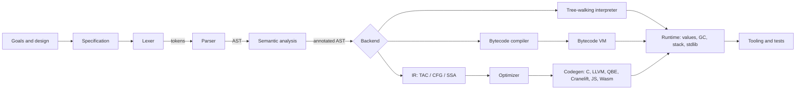

# Build a programming language step by step

**The shortest reliable route to a working programming language is to write down a narrow purpose and a small specification first, then build the implementation as a chain of small, individually testable stages: lexer, parser, abstract syntax tree (AST), semantic analysis, and one execution backend, with a tree-walking interpreter first, a bytecode virtual machine (VM) second, and a native or transpiling backend only if you need it.** A full dynamic scripting language with closures, classes, bytecode, and garbage collection fits in "a few thousand lines" of code ([Crafting Interpreters](https://craftinginterpreters.com)), and Wren's entire VM is under about 4,000 semicolons ([Wren](https://wren.io)), so the core is a weekend-to-month project, not a research program. The expensive part is everything around the core: the standard library, error messages, formatter, editor support, and documentation. Gleam took roughly five years from its first numbered release (April 2019) to 1.0 (March 2024) ([Wikipedia: Gleam](https://en.wikipedia.org/wiki/Gleam_(programming_language))), and good languages tend to budget for that surrounding work from the start. This guide walks the entire path in the order you would actually do it. Every code listing in Sections 4 through 8 (and the sample at the end of Section 9) was executed while preparing this guide (Python 3.13, rustc, gcc, clang 18), and the output shown is real. The tutorial's own pieces are the lexer, parser, tree-walking interpreter, resolver, type inferencer, bytecode VM, C and LLVM emitters, and optimizer; the spec-level worked example is a small invented language called Pebble. The guide ends with testing, bootstrapping, community, a phased roadmap, a reading list, and the mistakes that most often sink first language projects.

## Table of contents

1. [The pipeline at a glance](#1-the-pipeline-at-a-glance)
2. [Step 1: Goals, audience, and the design decisions that bind together](#2-step-1-goals-audience-and-the-design-decisions-that-bind-together)
3. [Step 2: Syntax, grammar, and a written specification](#3-step-2-syntax-grammar-and-a-written-specification)
4. [Step 3: Lexing, turning characters into tokens](#4-step-3-lexing-turning-characters-into-tokens)
5. [Step 4: Parsing and the abstract syntax tree](#5-step-4-parsing-and-the-abstract-syntax-tree)
6. [Step 5: Semantic analysis, scopes, closures, and types](#6-step-5-semantic-analysis-scopes-closures-and-types)
7. [Step 6: Execution, from tree-walker to bytecode VM to compiler](#7-step-6-execution-from-tree-walker-to-bytecode-vm-to-compiler)
8. [Step 7: Intermediate representations and optimization](#8-step-7-intermediate-representations-and-optimization)
9. [Step 8: Runtime, memory management, and concurrency](#9-step-8-runtime-memory-management-and-concurrency)
10. [Step 9: The standard library](#10-step-9-the-standard-library)
11. [Step 10: Tooling, from REPL to language server](#11-step-10-tooling-from-repl-to-language-server)
12. [Step 11: Testing a language implementation](#12-step-11-testing-a-language-implementation)
13. [Step 12: Bootstrapping and self-hosting](#13-step-12-bootstrapping-and-self-hosting)
14. [Step 13: Community, licensing, governance, and versioning](#14-step-13-community-licensing-governance-and-versioning)
15. [A phased roadmap for a solo developer](#15-a-phased-roadmap-for-a-solo-developer)
16. [Learning resources and reference implementations](#16-learning-resources-and-reference-implementations)
17. [Common mistakes and how to avoid them](#17-common-mistakes-and-how-to-avoid-them)
18. [Conclusion](#18-conclusion)

A note on evidence. Where this guide states a fact about a real language, library, or release, it cites the page that supports it. Where it gives engineering advice (for example, "write the S-expression printer before the parser"), that advice is synthesized from the cited sources plus standard practice and is not individually sourced. The sections on tooling time estimates, the roadmap, and common mistakes are explicitly of that second kind; treat the numbers as planning heuristics, not measurements.

## 1. The pipeline at a glance

Before any detail, fix the whole shape in your head. A language implementation is a pipeline in which each stage consumes the previous stage's output and produces something more structured and more explicit. The textbook decomposition has seven stages: scanning, parsing, static analysis, intermediate representation, optimization, code generation, and runtime ([Crafting Interpreters, A Map of the Territory](https://craftinginterpreters.com/a-map-of-the-territory.html)). The "front end" (scanning, parsing, static analysis) understands your language; the "back end" (code generation and runtime) targets a machine, real or virtual. The design and specification work that precedes all of this is part of the pipeline too, because it determines what every later stage must do.

```
 DESIGN ─► SPECIFICATION ─► ┌───────────────────────── FRONT END ──────────────────────────┐
 goals,     grammar,        │                                                             │
 non-goals  semantics,      │  source   ┌───────┐  tokens  ┌────────┐  AST   ┌─────────┐ │
 decisions  examples        │  text ───►│ Lexer │─────────►│ Parser │───────►│ Semantic│ │
                            │           └───────┘          └────────┘        │ analysis│ │
                            │          spans, trivia      recovery, errors   │ resolve │ │
                            │                                                │ + types │ │
                            └────────────────────────────────────────────────┴────┬────┴─┘
                                                                                  │ annotated AST
                  ┌─────────────────────────── MIDDLE / BACK END ─────────────────▼─────────────┐
                  │                                                                              │
                  │   (A) Tree-walking interpreter ──────────────────────────────────► run      │
                  │                                                                              │
                  │   (B) AST ─► Bytecode compiler ─► Bytecode VM ───────────────────► run      │
                  │                                                                              │
                  │   (C) AST ─► IR (TAC/CFG/SSA) ─► Optimizer ─► Codegen ─► C / LLVM / QBE /    │
                  │                                      Cranelift / JS / Wasm ─► native or host │
                  └───────────────────────────────────────┬──────────────────────────────────────┘
                                                          │
                   RUNTIME: values, heap + GC, call stack, strings, errors, FFI, stdlib
                                                          │
   TOOLING: REPL · formatter · test runner · docs · package manager · LSP · debugger · syntax grammar
   PROCESS: tests (golden, property, fuzz, differential) · bootstrapping · community · versioning
```

The same flow in Mermaid, for renderers that support it:



Three properties of this pipeline shape every decision in the rest of the guide. First, each arrow is a data structure, and the data structures are where you should put your design effort: a token with a source span, an AST node with a source span, a scope table that maps names to slots. If spans are missing at the token stage, you cannot recover them later, and every error message downstream suffers. Second, the stages are independent enough that you can swap the back end without touching the front end, which is exactly what makes the "interpreter first, VM later" strategy safe. Third, the pipeline is not strictly one-way in practice: implementing a stage reveals holes in the previous one (a grammar ambiguity found while writing the parser, a missing rule found while writing the evaluator), so the specification and its example programs are living documents that you revise as you build.

The table below is the one-page summary of what each stage consumes, produces, and is judged by. Return to it as a checklist.

| Stage | Input | Output | Done when |
|---|---|---|---|
| Design | A problem you care about | Problem statement, audience, non-goals, ranked values | You can state the wedge in one sentence |
| Specification | Design decisions | Grammar, semantics, error model, 10+ sample programs | Every sample program has a stated expected result |
| Lexer | Source text | Tokens with spans and decoded literal values | Goldens pass; never crashes or hangs on garbage |
| Parser | Tokens | AST with spans, plus diagnostics | Parses all samples; one error per mistake; fuzz-clean |
| Semantic analysis | AST | Names resolved to slots, types checked, tree annotated | Undefined names, type mismatches reported with spans |
| Execution backend | Annotated AST | Program output | Samples produce the specified output |
| IR and optimizer | AST | Flat, explicit IR; simplified IR | Optimized and unoptimized outputs agree on all tests |
| Runtime | Backend needs | Values, heap, GC, stack, builtins | No leaks or crashes in a stress test with GC forced on |
| Tooling | Everything above | CLI, REPL, formatter, LSP, docs | A newcomer can install and run a program in minutes |

## 2. Step 1: Goals, audience, and the design decisions that bind together

### Start from a pain point, not a feature list

Every well-documented successful language began with a concrete gap. Python started as a higher-level tool for system administration on the Amoeba distributed operating system, because C was too slow to write such utilities in and the Bourne shell did not fit Amoeba's primitives; Guido van Rossum wanted something that "bridges the gap between C and the shell" ([Python History blog](https://python-history.blogspot.com/2009/01/personal-history-part-1-cwi.html)). Go was motivated by the observation that existing languages forced a trade-off among efficient compilation, efficient execution, and ease of programming, and its goals included builds that take at most a few seconds for large programs and syntax that tools can analyze easily ([Go FAQ](https://go.dev/doc/faq)). Lua's goals were simplicity, small size, portability, speed, and easy embedding, and its authors favored "mechanisms, not policy": there is no built-in class system because tables plus metatables let users build their own ([Lua HOPL paper](https://www.lua.org/doc/hopl.pdf)). Notice the pattern: each of these is a sentence that begins with a problem for a specific kind of person. None begins "it will have pattern matching, generics, and macros."

Before you touch syntax, fill in the following worksheet in writing, one or two sentences per item. This is the cheapest insurance you can buy against a half-finished project, and it takes an hour.

The **problem statement** has the form "existing tools X and Y are bad at Z for people like W." If you cannot name Z, you are building for learning, which is a perfectly valid goal; say so explicitly, because it relaxes many constraints (nobody needs your language to be fast or complete). The **audience** answers who writes programs in this language: only you, beginners, data analysts, systems programmers, end users scripting a host application, or other programs (as with configuration and query languages). The audience decides how much syntax noise and type ceremony is tolerable. The **wedge** is the one thing your language does better than anything else for that audience: Lua is embedding, Go is servers with fast builds, Zig is explicit low-level control, Gleam is typed code on the Erlang VM, and Crystal is Ruby-like feel with native speed ([Crystal](https://crystal-lang.org/)). A language with no wedge competes on everything and wins at nothing. **Ranked design values** (three is enough) settle later arguments. A teaching language might rank (1) readable error messages, (2) a small core you can hold in your head, (3) predictable semantics with no implicit conversions; when someone proposes operator overloading, the ranking answers the question. Zig's stated philosophy of "no hidden control flow, no hidden memory allocations, no preprocessor, no macros" ([Zig overview](https://ziglang.org/learn/overview/)) is exactly a ranking of explicitness above convenience.

Then write at least five **non-goals**. Non-goals are the cheapest way to control scope, and the most mature languages publish them. Gleam's FAQ is effectively a published list: it aims to remain "a small and cohesive language with a minimal feature set" and deliberately excludes operator overloading, optional arguments, mutation, macros, and traits ([Gleam FAQ](https://gleam.run/frequently-asked-questions/)). For a first project, "no macros in v1, no inheritance, no user-defined operators, no JIT, no package registry" is a healthy starting list. Finally, record your **implementation constraints** (time, skill, target platform, performance floor) and a **success test**: a concrete deliverable such as "I can write a 200-line program that does a real task, and a friend can read it without a manual." Without a success test, a language project has no end.

A short design-values document is also worth writing in the style of Tim Peters' "Zen of Python," which captures Python's philosophy in a handful of aphorisms such as "Explicit is better than implicit," "Readability counts," "Errors should never pass silently," and "If the implementation is hard to explain, it's a bad idea" ([PEP 20](https://peps.python.org/pep-0020/)). You will return to it when a feature request tempts you.

### The running example: Pebble

To make the abstract steps concrete, this guide uses an invented language, Pebble, as the specification-level example, and a second tiny language, Mini, as the implemented example. Pebble's pitch is the kind of header every spec should open with. Its problem is that beginners writing small data-wrangling scripts hit confusing runtime type errors and unhandled failures in dynamic scripting languages. Its audience is beginner-to-intermediate programmers and students. Its wedge is "Python-readable, but the compiler forces you to handle failure and missing values." Its ranked values are explicitness about failure, a small core, and readable errors. Its non-goals for version 1 are concurrency, user-defined generics, inheritance, macros, operator overloading, a foreign function interface, a package manager, and a JIT. Its decision bundle is imperative plus functional multi-paradigm, static typing with local inference, no implicit conversions, `Option`/`Result` instead of null and exceptions, garbage collection supplied by the host language, immutable bindings by default, one file per module, and eager left-to-right evaluation. Pebble was designed for this guide; its grammar was verified by hand only and has not been run through a parser generator, so treat it as illustrative. Mini (Section 5 onward) is a smaller dynamically typed language whose lexer and parser are fully implemented and tested.

### The major design decisions, and why they come as bundles

Language design is a set of decisions that constrain one another, so choose a coherent bundle rather than shopping feature by feature. The safe default bundle for a first language is: a small multi-paradigm core with first-class functions, immutable-by-default bindings, a deliberately chosen typing discipline, garbage collection borrowed from the host language, `Result`-style errors, and modules equal to files. The following paragraphs walk each decision with real-world instances.

**Paradigm and data model.** Pick the data model first and the paradigm follows. Lua has a single data-structuring mechanism, the table, which serves as record, array, set, module, and object ([Lua HOPL](https://www.lua.org/doc/hopl.pdf)). Go separates concerns: methods can be implemented for any type, structs represent data, interfaces represent abstraction, and there is no type hierarchy ([Go FAQ](https://go.dev/doc/faq)). Lox, the teaching language of *Crafting Interpreters*, includes classes with single inheritance mainly because object orientation is widely used ([Crafting Interpreters, The Lox Language](https://craftinginterpreters.com/the-lox-language.html)). A practical modern default is first-class functions, records or structs, enumerations with data (sum types), and methods as sugar, without inheritance; both Go and Rust avoid class inheritance.

**Typing.** People conflate two independent axes. Static versus dynamic is about when types are checked. Strong versus weak is informal and is about how much implicit conversion is allowed; JavaScript's `"1" + 1` is weak, while Lox's rule that equality never converts types (so `123 == "123"` is false) is strong. Define your own coercion rules in the spec; the best default is none, or only integer-to-float in arithmetic. Dynamic typing is legitimately the simplest choice: Lox chose it to keep the language and implementation simple ([Lox chapter](https://craftinginterpreters.com/the-lox-language.html)), and it removes the type checker, which is typically half of a compiler's front end. Static typing buys earlier errors and performance but multiplies design work. If you go static, inference comes in tiers: local inference (Go's `:=`, Rust's `let`) is easy to implement; Hindley-Milner inference needs unification and is a good intermediate-level project (Section 6 implements it in about ninety lines); Crystal-style global inference with flow typing, where a `String | Nil` narrows to `String` after a nil check ([Crystal](https://crystal-lang.org/)), is much harder and should not be your first attempt. For null, choose between `nil` everywhere (Lox, Lua), nullable types with flow typing (Crystal), or `Option[T]` (Gleam, Rust); `Option` is the most explicit.

**Generics.** Defer user-defined generics. Go omitted generics at first because they cost complexity in the type system and runtime, then added type parameters in Go 1.18; it chose square brackets over angle brackets because `a, b = w < x, y > (z)` cannot be parsed without type information ([Go FAQ](https://go.dev/doc/faq)). Even in 2026, generics are still being refined: Go 1.26 allowed self-referential generic constraints ([Go 1.26 release notes](https://go.dev/doc/go1.26)). The cheapest compromise is built-in generic containers (`List[T]`, `Map[K,V]`, `Option[T]`, `Result[T,E]`) that the type checker understands but users cannot define, which is Go's pre-1.18 approach. Avoid traits, typeclasses, and constrained interfaces in version 1; Gleam rejects them citing hard-to-follow code, confusing error messages, and compile and runtime costs ([Gleam FAQ](https://gleam.run/frequently-asked-questions/)). Prefer `List[Int]` notation to avoid the `<`/`>` ambiguity.

**Memory management.** Go chose garbage collection because manual management consumes programmer time and causes pernicious bugs, and because GC simplifies concurrent code where object lifetimes cross threads ([Go FAQ](https://go.dev/doc/faq)). Zig takes the opposite stance: functions that allocate take an allocator parameter, so the caller chooses the strategy and handles failure ([Zig overview](https://ziglang.org/learn/overview/)). For a first language, if you implement in a garbage-collected host language (Python, Java, JavaScript, Go, OCaml), you inherit a collector for free, and that should be your default unless memory control is your wedge. Ownership and borrowing (Rust) gives memory safety without GC but requires a borrow checker, which is an advanced project and not suitable as the central feature of a first language.

**Error handling.** There are four families: exceptions (Java, Python), error return values (Go's `(value, error)`), sum-type results with propagation sugar (`Result` plus Rust's `?`, Zig's `try`, Gleam's `use`), and crash-or-assert. Go argues that exceptions yield convoluted code and encourage labelling ordinary failures, such as failing to open a file, as exceptional ([Go FAQ](https://go.dev/doc/faq)). Zig makes errors values the compiler will not let you ignore ([Zig overview](https://ziglang.org/learn/overview/)). For a typed language, `Result` pairs best with exhaustive `match`; for a dynamic one, exceptions are easier to implement. In every case, separate **panics** (bugs such as divide by zero or index out of bounds) from **errors** (expected failures), as Go does with `panic` versus `error`.

**Evaluation order and short-circuiting.** Choose call-by-value with left-to-right argument evaluation and write that order into the spec; C's habit of leaving evaluation order unspecified is a historic source of bugs. State whether `and`/`or` short-circuit (they should) and whether they return operand values, as Lox does, or only booleans.

**Concurrency, mutability, modules.** Defer concurrency for version 1 unless it is your niche, and write "single-threaded semantics in v1; concurrency reserved" in the spec. Go uses CSP-derived channels and lightweight goroutines ([Go FAQ](https://go.dev/doc/faq)); Lua uses coroutines ([Lua HOPL](https://www.lua.org/doc/hopl.pdf)). Make bindings immutable by default with an explicit `mut`, which makes programs easier to reason about and closure capture simpler. For modules, the simplest design is one file equals one module, with explicit `pub` exports and no cyclic imports; defer packages and versioning.

The dependencies among these choices are the reason to choose a bundle. Static typing plus sum types leads to exhaustive `match`, which leads naturally to `Option`/`Result` error handling. Garbage collection makes closures and concurrency easy. Manual memory leads to allocator parameters, which leads to "no hidden allocations," which leads to no operator overloading and no exceptions, the explicitness theme that runs through Zig. Immutability simplifies concurrency and value semantics. A frequent beginner error is copying a famous language's surface without its constraints, for example adding both exceptions and result types, or both classes and prototypes.

### Lessons from the design histories

Reading how existing languages evolved teaches more than any checklist. Python grew out of the ABC language, keeping its accessibility goal while fixing its problems, and evolved with frequent releases and user feedback ([Python History blog](https://python-history.blogspot.com/2009/01/personal-history-part-1-cwi.html)). Lua evolved by replacing its extension mechanism three times (fallbacks in 2.1, tag methods in 3.0, metatables in 5.0) rather than merely adding features, and moved to a register-based VM and incremental GC in 5.1 ([Lua HOPL](https://www.lua.org/doc/hopl.pdf)). Go declared a compatibility promise and still iterates: version 1.26, released February 2026, added `new(expr)`, made the "Green Tea" garbage collector the default (with an expected 10 to 40 percent reduction in GC overhead for GC-heavy programs), and rewrote `go fix` ([Go 1.26 notes](https://go.dev/doc/go1.26)). Zig remains pre-1.0 and openly makes breaking changes; version 0.17, released 2026-10-01, removed `@cImport` in favor of an external translate-c package ([Linuxiac](https://linuxiac.com/?p=220546), [Zig downloads](https://ziglang.org/download/)).

Several lessons recur. Constrain scope to one pain point. Say no loudly and publish it, as the Go and Gleam FAQs do, which reduces repeat debates. Defer expensive features but reserve syntax for them so adding them later is not a breaking change: reserve a few keywords such as `async`, `await`, and `trait`. Explicitness is a recurring value, and hidden control flow (exceptions, operator overloading, implicit conversions) is what several of these languages removed. A small number of powerful mechanisms can replace many special features, but Nystrom's "waterbed theory" warns that complexity pushed out of one place resurfaces elsewhere ([Lox chapter](https://craftinginterpreters.com/the-lox-language.html)). Tooling is part of the language. And decide early whether you are experimental (breaking changes are fine) or stable. For a one-person project, keep a `DESIGN.md` log of decisions and rejected alternatives; it plays the role of Rust's formal RFC process, in which substantial changes go through draft, pull-request review, a team decision, and a tracking issue ([Rust RFC 0002](https://github.com/rust-lang/rfcs/blob/master/text/0002-rfc-process.md)). A miniature "mini-RFC" template mirrors that structure: summary, motivation (a program that is painful today), detailed design (syntax, semantics, two examples), alternatives considered, drawbacks, and open questions.

## 3. Step 2: Syntax, grammar, and a written specification

### Syntax design choices

Surface syntax is cheaper to change than semantics, so decide the data model, evaluation rules, and error model first, and bikeshed keywords afterward. Even so, a few syntax choices have large downstream consequences for the parser, and they are worth deciding deliberately.

Choose a syntactic family: C-like (braces and semicolons), Python-like (indentation), Lisp-like (S-expressions), or ML-like. S-expressions make parsing trivial, which is attractive for a first implementation, at the cost of reader acceptance. Keep the keyword set small (Lox has about sixteen) and avoid keywords that are common identifiers. On statement terminators, semicolons make parsing and error recovery easy because the parser can synchronize on `;`; newline-terminated statements (Go, Python) require lexer rules, and Go inserts semicolons automatically based on the last token of a line, which is a source of subtle bugs. On whitespace, significant indentation reads well and enforces layout but needs the lexer to generate INDENT and DEDENT tokens (Section 4 shows how), creates tab/space problems, and makes one-line lambdas awkward; a pragmatic hybrid is braces plus a canonical formatter, Go's approach. Go's syntax was designed to be easy to analyze by tools, with `gofmt` enforcing one format ([Go FAQ](https://go.dev/doc/faq)).

For operators, keep to the C-family table most programmers know, avoid surprising precedence such as C's bitwise-versus-comparison trap (`a & b == c`), and decide whether comparisons chain. Python's `a < b < c` is nice but requires special semantics; the simplest options are to forbid chaining in the grammar (Pebble's choice) or to build a dedicated n-ary node. Make assignment a statement, not an expression, to avoid C's `if (x = 1)` bug. Define literal forms early: digit separators like `1_000`, hexadecimal, whether `1.` or `.5` is legal, string escapes, multi-line strings, and whether block comments nest. If blocks evaluate to their last expression (as in Rust), specify the semicolon rule precisely and watch for the classic conflict between `if x { ... }` and struct-literal syntax `Name { ... }`; Pebble avoids it by constructing records as `Name(field: value)`. Finally, run a readability test: write the same thirty-line program in three candidate syntaxes and read each one aloud.

### Grammars, EBNF, and where precedence lives

A context-free grammar is a set of productions, each with a head (a single nonterminal) and a body of terminals and nonterminals; several rules with the same head act as alternatives. Regular languages, the power level of a scanner, cannot express arbitrary nesting, but context-free grammars can, which is why lexing and parsing are separate stages ([Crafting Interpreters, Representing Code](https://craftinginterpreters.com/representing-code.html)). Keep a **lexical grammar** (how characters form tokens) separate from a **syntactic grammar** (how tokens form structure). The notation used below is an ISO-style EBNF flavor: `=` defines, `;` ends a rule, `|` separates alternatives, `{ x }` means zero or more, `[ x ]` means optional, parentheses group, quoted text is a literal terminal, and UPPER_CASE names are tokens produced by the lexer. This maps onto the common regex-flavored BNF as `{ x }` equals `x*` and `[ x ]` equals `x?`. Every project defines its own notation, so state yours at the top of the spec.

A naive expression rule such as `binary = expression operator expression` is ambiguous, because `6 / 3 - 1` can group two ways. Precedence (which operator binds tighter) and associativity (how same-level operators group) resolve this, and the standard encoding is a stratified grammar with one rule per precedence level, each referring only to the next tighter level ([Crafting Interpreters, Parsing Expressions](https://craftinginterpreters.com/parsing-expressions.html)). Here is Pebble's complete lexical grammar.

```ebnf
(* Tokens. Whitespace (space, tab, newline) separates tokens and is otherwise ignored. *)
LETTER   = "a".."z" | "A".."Z" | "_" ;
DIGIT    = "0".."9" ;
IDENT    = LETTER , { LETTER | DIGIT } ;          (* minus reserved words *)
INT      = DIGIT , { DIGIT | "_" } ;
FLOAT    = INT , "." , DIGIT , { DIGIT } ;
STRING   = '"' , { CHAR | ESCAPE } , '"' ;         (* ESCAPE = "\n" | "\t" | "\\" | "\"" *)
COMMENT  = "//" , { any character except newline } ;   (* discarded by the lexer *)

(* Reserved words: fn let mut if else match while for in return
   true false enum type import pub and or not  *)
```

And its syntactic grammar, in which every expression level calls only the next tighter one, which is what removes the ambiguity.

```ebnf
program     = { import_decl } , { top_decl } ;
import_decl = "import" , IDENT , ";" ;
top_decl    = [ "pub" ] , ( fn_decl | type_decl | enum_decl | let_decl ) ;

fn_decl     = "fn" , IDENT , "(" , [ params ] , ")" , [ "->" , type ] , block ;
params      = param , { "," , param } , [ "," ] ;
param       = IDENT , ":" , type ;

type_decl   = "type" , IDENT , "=" , "{" , field , { "," , field } , [ "," ] , "}" ;
field       = IDENT , ":" , type ;
enum_decl   = "enum" , IDENT , "{" , variant , { "," , variant } , [ "," ] , "}" ;
variant     = IDENT , [ "(" , type , { "," , type } , ")" ] ;

type        = IDENT , [ "[" , type , { "," , type } , "]" ] ;   (* Int, List[Int], Result[Int, Text] *)

block       = "{" , { statement } , [ expr ] , "}" ;            (* trailing expr (no ;) is the block's value *)

statement   = let_decl
            | assign_stmt
            | "return" , [ expr ] , ";"
            | while_stmt
            | for_stmt
            | expr , ";" ;
let_decl    = "let" , [ "mut" ] , IDENT , [ ":" , type ] , "=" , expr , ";" ;
assign_stmt = lvalue , "=" , expr , ";" ;
lvalue      = IDENT , { "." , IDENT } ;
while_stmt  = "while" , expr , block ;
for_stmt    = "for" , IDENT , "in" , expr , block ;

(* Expressions, lowest to highest precedence. Each level only refers to the next one down. *)
expr        = or_expr ;
or_expr     = and_expr , { "or" , and_expr } ;                       (* left assoc, short-circuit *)
and_expr    = not_expr , { "and" , not_expr } ;                      (* left assoc, short-circuit *)
not_expr    = "not" , not_expr | compare ;                           (* prefix, right assoc *)
compare     = term , [ ( "==" | "!=" | "<" | "<=" | ">" | ">=" ) , term ] ;   (* NON-associative *)
term        = factor , { ( "+" | "-" ) , factor } ;                  (* left assoc *)
factor      = unary , { ( "*" | "/" | "%" ) , unary } ;              (* left assoc *)
unary       = "-" , unary | postfix ;                                (* right assoc *)
postfix     = primary , { call_args | "." , IDENT | "?" } ;          (* call, field access, error-propagation *)
call_args   = "(" , [ arg , { "," , arg } , [ "," ] ] , ")" ;
arg         = [ IDENT , ":" ] , expr ;                               (* positional or named *)

primary     = INT | FLOAT | STRING | "true" | "false"
            | IDENT
            | "(" , expr , ")"
            | list_lit
            | if_expr
            | match_expr
            | block ;
list_lit    = "[" , [ expr , { "," , expr } , [ "," ] ] , "]" ;
if_expr     = "if" , expr , block , [ "else" , ( if_expr | block ) ] ;
match_expr  = "match" , expr , "{" , arm , { "," , arm } , [ "," ] , "}" ;
arm         = pattern , "=>" , expr ;
pattern     = "_" | INT | STRING | "true" | "false" | IDENT
            | IDENT , "(" , [ pattern , { "," , pattern } ] , ")" ;
```

| Level | Operators | Associativity |
|---|---|---|
| 1 (loosest) | `or` | left |
| 2 | `and` | left |
| 3 | `not` | prefix |
| 4 | `==` `!=` `<` `<=` `>` `>=` | none (non-chaining) |
| 5 | `+` `-` | left |
| 6 | `*` `/` `%` | left |
| 7 | unary `-` | prefix |
| 8 (tightest) | call `()`, field `.`, propagate `?` | left (postfix) |

A good spec lists its own known limitations, and Pebble has two worth studying. First, `if` is an expression, so `let x = if c { 1 } else { 2 };` is valid, but as a statement it needs a rule about trailing semicolons: version 1 intends that a block-bodied `if`, `match`, `while`, or `for` at statement position may omit the semicolon, an exception the EBNF above does not express. This is the kind of loose end a real spec review catches, and you should resolve it either with a "layout notes" section or by simplifying the grammar to always require `;`. Second, Pebble is almost LL(1) except that an identifier can begin either an assignment statement or an expression, so the parser parses an expression and then, if `=` follows, validates that it is a legal lvalue. This "parse as expression, then validate" trick is common.

Grammar hygiene follows from how you will parse. Eliminate left recursion by iteration (`{ }`) for top-down parsers. Aim for a grammar where one token of lookahead picks the production; if a construct needs unbounded lookahead, such as distinguishing a generic call from a comparison, change the syntax rather than the parser. Test the grammar by running every sample program through the parser and by deliberately writing bad programs.

### Semantics: what the program means

Syntax says what is a program; semantics says what a program does. There are three layers worth knowing, and only the first two matter for a practical language. **Informal semantics** (English plus examples) is fine for most languages, provided it is precise: every construct gets its syntax, its static rules (what makes it ill-formed), its dynamic behavior, its error cases, and an example. Use the RFC 2119 words MUST and MAY for implementer requirements. **Operational semantics** describes execution as transitions of an abstract machine. Small-step rules (`e -> e'`) are good for reasoning about evaluation order and non-termination; big-step rules (`env |- e => v`) mirror a tree-walking interpreter almost line for line, which makes them the best fit for a first language, because the spec rule becomes the interpreter code. In a statically typed language, add **typing rules** (`G |- e : T`) and aim informally for the property that well-typed programs do not get stuck, except for declared panics. Denotational semantics, which maps programs to mathematical functions, is elegant but heavy and can be skipped unless you want to study it.

Here are Pebble's static rules in prose. Every expression has exactly one static type and there are no implicit conversions, so `1 + 2.0` is a type error and you must write `to_float(1) + 2.0`. `let x = e;` infers the type of `x` from `e` unless annotated. Bindings are immutable unless declared `mut`, so assignment to a non-`mut` binding is a compile-time error. `if c { a } else { b }` requires `c : Bool` and both branches of the same type. A `match` must be exhaustive over the enum's variants, or contain `_`. `e?` is legal only inside a function whose return type is `Result[_, E]` where `e : Result[T, E]` with the same `E`, and it has type `T`. Name resolution is lexical, inner `let` may shadow outer names, using a name before its declaration in the same block is an error, and top-level functions may be mutually recursive.

The same rules in judgment form, where `G` maps names to types:

```
 x : T in G                      G |- a : Int    G |- b : Int         G |- c : Bool   G |- a : T   G |- b : T
 -------------  (Var)           ------------------------- (Add-Int)  ------------------------------------- (If)
 G |- x : T                      G |- a + b : Int                      G |- if c { a } else { b } : T

 G |- f : (T1,...,Tn) -> R      G |- ai : Ti  (each i)
 ------------------------------------------------------ (Call)
 G |- f(a1,...,an) : R

 G |- e : Result[T,E]     function return type is Result[U,E]
 ------------------------------------------------------------ (Try)
 G |- e? : T
```

And the dynamic semantics as big-step rules, where `env` maps names to values and `=>` means "evaluates to":

```
 n is an integer literal            env(x) = v
 -----------------------  (Lit)     ------------  (Var)
 env |- n => n                      env |- x => v

 env |- a => v1     env |- b => v2     v = v1 + v2 (panic on overflow)
 ------------------------------------------------------------------- (Add)
 env |- a + b => v
 [a is evaluated before b: left-to-right is part of the language]

 env |- c => true     env |- a => v           env |- c => false    env |- b => v
 -------------------------------- (If-T)     ---------------------------------- (If-F)
 env |- if c {a} else {b} => v               env |- if c {a} else {b} => v

 env |- a => false                            env |- a => true    env |- b => v
 ----------------------- (And-short)          --------------------------------- (And-rhs)
 env |- a and b => false                       env |- a and b => v

 env |- e => Ok(v)                            env |- e => Err(x)
 ----------------- (Try-ok)                  ------------------------------------------ (Try-err)
 env |- e? => v                               current function returns Err(x) immediately
```

A function call evaluates the callee, then the arguments left to right, binds the parameters in a fresh environment that extends the closure's captured environment (lexical scoping), and evaluates the body; `return v` exits the nearest enclosing function. State explicitly that closures capture variables by reference to the binding, so captured `mut` bindings are shared and later changes are visible. Pebble panics (unrecoverable in version 1) on integer overflow, divide by zero, list index out of range, impossible non-exhaustive match, and stack overflow; a panic prints a message and stack trace to stderr and exits with status 101, an arbitrary choice that you document. Its values are `Int` (64-bit signed), `Float` (IEEE 754 double), `Bool`, `Text` (immutable UTF-8), `List[T]`, records, enums, functions, `Unit`, and the built-in generic enums `Option[T] = Some(T) | None` and `Result[T,E] = Ok(T) | Err(E)`.

### What a complete specification contains

Real specifications are explicit about their scope. The Rust Reference describes itself as the primary reference but not a tutorial, covers only stable Rust, uses stable rule identifiers (while noting the identifiers themselves are not yet stable), links some rules to tests, admits known bugs and omissions, and says nothing about which optimizations the compiler performs, telling readers to treat programs as black boxes whose observable behavior must match ([Rust Reference](https://doc.rust-lang.org/reference/introduction.html)). Crystal organizes its formal specification by topic: type inference, nil, union types, concurrency, and so on ([Crystal reference](https://crystal-lang.org/reference/latest/syntax_and_semantics/)). A solid outline for your own spec is the following sequence of chapters: introduction (purpose, goals, non-goals, version, what is normative); notation and conventions; lexical structure; syntax with the full grammar and precedence table; types; declarations and scope; expressions, each with its typing rule, evaluation rule, and errors; statements; functions (including evaluation order and whether tail calls are guaranteed); the error model; modules; the memory model; the minimal standard library; program execution (entry point, arguments, exit status); a list of implementation-defined and unspecified behaviors; and appendices for the grammar, reserved words, changelog, and rejected ideas.

Three habits make a spec useful. Define terms once. Use "undefined," "unspecified," and "implementation-defined" deliberately and minimize undefined behavior, since it is what makes C hard. Give an example for every rule, including at least one failing example with its expected error. Pair the spec with a test corpus so that each normative statement has at least one conformance test; the tests double as documentation. Write the spec before the interpreter, and expect the implementation to find holes in it.

### Sample programs, including the ones that must fail

Write programs before you write a parser. They are your acceptance tests. Here are four positive Pebble programs. The first exercises variables and loops; the second shows `if` as an expression; the third shows explicit failure handling with `Result` and `?`; the fourth shows records, enums, and exhaustive matching.

```pebble
// hello.peb
fn main() {
    let name = "world";
    print("Hello, " + name + "!");
    let mut total = 0;
    for n in range(1, 6) {          // 1..5
        total = total + n * n;
    }
    print("Sum of squares: " + to_text(total));   // 55
}
```

```pebble
fn fizzbuzz(n: Int) -> Text {
    if n % 15 == 0 { "FizzBuzz" }
    else if n % 3 == 0 { "Fizz" }
    else if n % 5 == 0 { "Buzz" }
    else { to_text(n) }
}

fn main() {
    for i in range(1, 16) {
        print(fizzbuzz(i));
    }
}
```

```pebble
enum ParseError { Empty, NotANumber(Text) }

fn parse_int(s: Text) -> Result[Int, ParseError] {
    if s == "" { return Err(Empty); }
    match int_from_text(s) {          // built-in returning Option[Int]
        Some(n) => Ok(n),
        None    => Err(NotANumber(s)),
    }
}

fn add_strings(a: Text, b: Text) -> Result[Int, ParseError] {
    let x = parse_int(a)?;     // early-returns Err(...) on failure
    let y = parse_int(b)?;
    Ok(x + y)
}

fn main() {
    match add_strings("40", "2") {
        Ok(n)  => print("sum = " + to_text(n)),
        Err(e) => print("failed"),
    }
}
```

```pebble
type Point = { x: Float, y: Float }

enum Shape {
    Circle(Float),
    Rect(Float, Float),
    Dot,
}

fn area(s: Shape) -> Float {
    match s {
        Circle(r)  => 3.14159 * r * r,
        Rect(w, h) => w * h,
        Dot        => 0.0,
    }
}

fn main() {
    let p = Point(x: 1.0, y: 2.5);
    print(to_text(p.x + p.y));
    print(to_text(area(Rect(2.0, 3.0))));   // 6.0
}
```

Equally important are the negative examples, each paired with the error the implementation must produce. These become your negative golden tests later.

```pebble
let x = 1;
x = 2;                    // error: cannot assign to immutable binding 'x'
let y = 1 + 2.0;          // error: operator '+' expects (Int, Int) or (Float, Float), got (Int, Float)
a < b < c                 // syntax error: comparison operators do not chain
match s { Circle(r) => r }   // error: non-exhaustive match, missing Rect, Dot
fn f() -> Int { parse_int("1")? }   // error: '?' needs Result return type
```

Finally, keep a rationale log (`DESIGN.md`). Pebble's entries read: no exceptions, following the Go/Zig/Gleam line that ordinary failures should be visible in values, with `?` removing the verbosity Go is often criticized for; immutable by default for simpler reasoning and safe closure capture; non-chaining comparisons to avoid the `a < b < c` pitfall; square-bracket generics from Go's parse-ambiguity argument; and no implicit numeric conversion for strong typing. Go's own FAQ is a model of this practice, documenting design rationale as questions and answers alongside a separate formal spec ([Go FAQ](https://go.dev/doc/faq)).

## 4. Step 3: Lexing, turning characters into tokens

### What a lexer does and the rules that matter

A lexer (also called a scanner or tokenizer) converts a stream of characters into a flat stream of tokens. A **lexeme** is the raw substring for one unit of the language, and a **token** is the lexeme plus its category, any decoded literal value, and its location ([Crafting Interpreters, Scanning](https://craftinginterpreters.com/scanning.html)). The lexer discards whitespace and comments (in a compiler front end) and hands the parser something much easier to consume than raw characters. A small number of rules do almost all the work.

The first rule is **maximal munch**: when several lexical rules match at a position, take the longest. That is why `<=` lexes as one token rather than `<` followed by `=`, and why `orchid` is a single identifier rather than the keyword `or` followed by `chid`. The second rule: scan keywords as identifiers first, then look the text up in a reserved-word table; a hit produces the keyword's token type ([Crafting Interpreters, Scanning](https://craftinginterpreters.com/scanning.html)). The third rule is that the lexer must never get stuck. On a bad character or an unterminated string, report the error with a location, still consume at least one character so the loop makes progress, emit an `ERROR` token, and keep scanning so that several errors surface in one run.

### Token design checklist

Represent a token as a kind, a span, and the raw text, adding a decoded `value` only for literals; decode escape sequences and integers once, in the lexer. Use one token kind per keyword and punctuator (this makes the parser's `match` exhaustive), a few classes for identifiers and literals, plus `EOF` and `ERROR`. An `ERROR` token rather than a thrown exception lets the parser keep going and lets an editor tokenize broken code. Always emit exactly one trailing `EOF`, and make `advance()` idempotent at EOF so lookahead never indexes out of range.

Store positions as start and end offsets only, and derive line and column on demand (count newlines before the offset, or build a line-start table and use binary search for speed). Decide column units up front, because editors differ: bytes, UTF-16 code units (the Language Server Protocol default), or Unicode scalar values. Tree-sitter 0.27.0 even added UTF-16 support in highlighting, a sign that editors care ([tree-sitter releases](https://github.com/tree-sitter/tree-sitter/releases)). Keep whitespace and comments as discardable "trivia" for a compiler, but attach them to tokens (or emit them as separate trivia tokens) if you will later need a lossless syntax tree for a formatter. Handle numbers carefully: do not treat `.` as part of a number unless a digit follows (so `1.foo` and `1..2` lex sanely), require a digit after `e[+-]`, and leave the leading minus sign to the parser as unary minus. In strings, report an unknown escape with the span of just the escape, and end an unterminated string at the end of the line. The reason is practical: the author of the reference lexer observed that without the newline rule, a stray `"` swallowed the rest of the file and every later error was lost.

There are three ways to build the scanner. A hand-written loop is fastest, gives the best errors, and is the most flexible, and it is what the code below does. A single big regular-expression alternation is compact (the indentation example uses one) but requires you to order alternatives longest-first. A generated DFA (`logos` in Rust, `flex`, ANTLR lexer rules) is useful once the language stabilizes. A caution: some languages need context-sensitive lexing (the C typedef problem, splitting `>>` in generics, regex versus division in JavaScript, string interpolation modes); this guide gives no tested code for those, so treat them as design-time checks.

### The complete Mini lexer

The lexer for Mini is the first third of `mini.py`, which also contains the AST and the parser, and which appears in full in Section 5. It was tested with these verified behaviors: the input `a<=1.5e2 "x\ty" // c\n /* a /* nested */ b */ c` lexes to `IDENT LE FLOAT STRING IDENT EOF`, with the float value 150.0 and the string containing a real tab; and `1.foo` lexes as `INT` followed by an `ERROR` token for the `.`. Block comments nest, tracked by a depth counter, and an unterminated block comment is a diagnostic rather than a crash. Read the `Lexer` class there now; the `_skip_trivia`, `next`, `_number`, and `_string` methods map one-to-one onto the rules above.

### Significant indentation as a layer

If your language uses indentation like Python, handle it as a small stack-based layer that sits on top of tokenization and emits `NEWLINE`, `INDENT`, and `DEDENT`. Python's algorithm is documented precisely: a stack starts as `[0]`; indentation is checked only at the start of a logical line; greater indentation pushes and emits one `INDENT`; smaller indentation must match a stack entry, popping and emitting one `DEDENT` per pop, or else it is an `IndentationError`; at end of file, emit one `DEDENT` per remaining nonzero entry. Tabs advance to the next multiple of 8 columns, ambiguous tab-space mixing raises `TabError`, blank or comment-only lines produce no tokens, and inside `()[]{}` line breaks produce no `NEWLINE` and continuation indentation is not checked ([Python reference, Lexical analysis](https://docs.python.org/3/reference/lexical_analysis.html)). The runnable implementation below follows those rules.

```python
# indent.py
"""Indentation-sensitive lexer layer: NEWLINE / INDENT / DEDENT (Python-style). Tabs = next multiple of 8."""
import re
TOKEN = re.compile(r"""
   (?P<WS>[ \t]+) | (?P<COMMENT>\#[^\n]*) | (?P<NL>\n)
 | (?P<NUM>\d+) | (?P<NAME>[A-Za-z_]\w*) | (?P<OP>[()\[\]{}:,=+\-*/<>])
""", re.X)

class IndentError(Exception): pass

def lex(src: str):
    out, stack, depth = [], [0], 0      # depth = open-bracket nesting
    pos, line_start, n = 0, True, len(src)
    while pos < n:
        if line_start and depth == 0:
            col, p = 0, pos
            while p < n and src[p] in " \t":
                col = (col // 8 + 1) * 8 if src[p] == "\t" else col + 1
                p += 1
            if p >= n: pos = p; break
            if src[p] == "\n" or src[p] == "#":        # blank/comment-only line: ignore entirely
                nl = src.find("\n", p); pos = n if nl == -1 else nl + 1; continue
            pos, line_start = p, False
            if col > stack[-1]:
                stack.append(col); out.append(("INDENT", col))
            else:
                while col < stack[-1]:
                    stack.pop(); out.append(("DEDENT", stack[-1]))
                if col != stack[-1]:
                    raise IndentError(f"inconsistent dedent to column {col}")
        m = TOKEN.match(src, pos)
        if not m: raise IndentError(f"bad char {src[pos]!r} at {pos}")
        pos, k = m.end(), m.lastgroup
        if k in ("WS", "COMMENT"): continue
        if k == "NL":
            if depth == 0: out.append(("NEWLINE", None)); line_start = True
            continue                                   # newline inside brackets is just whitespace
        if k == "OP":
            depth += m.group() in "([{"; depth -= m.group() in ")]}"
        out.append((k, m.group()))
    if out and out[-1][0] not in ("NEWLINE", "DEDENT"): out.append(("NEWLINE", None))
    while len(stack) > 1: stack.pop(); out.append(("DEDENT", stack[-1]))
    out.append(("EOF", None))
    return out

if __name__ == "__main__":
    src = "if x:\n    y = (1 +\n  2)\n\n    # c\n    if z:\n        w\nq\n"
    print(" ".join(k if v is None or k in("INDENT","DEDENT") else v for k, v in lex(src)))
    try: lex("if x:\n    a\n  b\n")
    except IndentError as e: print("err:", e)
```

Running it prints `if x : NEWLINE INDENT y = ( 1 + 2 ) NEWLINE if z : NEWLINE INDENT w NEWLINE DEDENT DEDENT q NEWLINE EOF`, and the malformed input raises `inconsistent dedent to column 2`. Five details deserve attention. Indentation is measured only when `line_start and depth == 0`. Blank and comment-only lines are skipped before the comparison, so they never produce tokens. DEDENTs are emitted in a loop, because one line can close several blocks at once. The final `NEWLINE` is synthesized if the file lacks a trailing newline. And once this layer exists, the parser treats `INDENT` and `DEDENT` exactly like `{` and `}`. A production version would add a distinct error for tab and space inconsistency, backslash line continuation, and mode stacks for interpolated strings.

## 5. Step 4: Parsing and the abstract syntax tree

### Choosing a parsing technique

The parser turns the token stream into a tree. For a new language, the practical default is a hand-written recursive-descent parser with a Pratt (binding-power) loop for expressions. Recursive descent is top-down and hand-written: each grammar rule becomes a function, terminals match and consume tokens, nonterminals are function calls, alternatives become `if` or `switch`, repetition becomes a loop, and one token of lookahead picks the branch. Left recursion breaks it because the function would call itself without consuming input, and the Crafting Interpreters chapter notes that major production compilers use this technique ([Parsing Expressions](https://craftinginterpreters.com/parsing-expressions.html)). The reason to prefer it is control: you get the best error messages and recovery, you can handle context-sensitive constructs in ordinary code, and you have no tool dependency. Its costs are that you maintain it yourself, it leaves no grammar artifact behind, and it is easy to leave an ambiguity unnoticed.

| Approach | Grammar class | Strengths | Weaknesses | Choose when |
|---|---|---|---|---|
| Hand-written recursive descent plus Pratt | LL(k)-ish, context via code | Best errors and recovery, fast, no dependency | You maintain it; ambiguity goes unnoticed | A real language implementation |
| ANTLR | LL(*)-like, rewrites direct left recursion | Grammar as spec, many targets, generated listeners and visitors | Runtime dependency; generic default errors | Multi-language ecosystems, DSLs |
| LR/LALR (yacc, bison, Menhir, LALRPOP, Lark-LALR) | LR(1)/LALR(1) | Linear time; conflicts reported at build time | Conflict debugging is hard; awkward recovery | Clean grammar where you want ambiguity detected |
| GLR/Earley (Lark Earley) | Any context-free grammar | Tolerates ambiguous or ugly grammars | Slower; ambiguity needs priorities | Prototyping, legacy grammars |
| PEG/packrat (pest) | Ordered choice | Unambiguous by construction, scannerless | Ordered choice can shadow alternatives; no left recursion without extensions | Config formats, DSLs, prototypes |
| Parser combinators (nom, winnow, chumsky) | Typically PEG-like | Grammar is host-language code, composable | Type and compile-time complexity in Rust; error quality varies | Binary/text formats; error-tolerant tools |
| tree-sitter | LR-style with GLR conflict handling, incremental | Incremental, error-tolerant syntax tree; bindings everywhere | Syntax tree only, no semantic checks; grammar in a JavaScript DSL | Editor features: highlighting, folding, navigation |

This table is the author's synthesis, not a cited ranking. The cited facts behind it are these. Lark offers Earley (any context-free grammar, worst case O(n^3) but close to linear for most LR grammars, with ambiguity exposed through `ambiguity='explicit'`), LALR(1) (fast, low memory, with a "contextual lexer"), and CYK; its docs advise preferring left recursion with LALR and using terminal priority only as a last resort ([Lark docs](https://lark-parser.readthedocs.io/en/latest/parsers.html)). Tree-sitter is an incremental parser generator whose goals are generality, speed fast enough to re-parse on every keystroke, and robustness to syntax errors, with a dependency-free C11 runtime and bindings for Python, Rust, Go, JavaScript, Swift and others ([Tree-sitter docs](https://tree-sitter.github.io/tree-sitter/)). Its release page showed v0.27.0 with UTF-16 highlighting support ([tree-sitter releases](https://github.com/tree-sitter/tree-sitter/releases)). The ANTLR docs describe it as a parser generator for reading, processing, executing, or translating structured text or binary files, with 4.13.2 the latest release shown ([ANTLR releases](https://github.com/antlr/antlr4/releases)). In Rust, chumsky 0.13.0 (2026-05-06) advertises error recovery that reports errors yet produces a partial AST, with an optional `pratt` feature ([docs.rs chumsky](https://docs.rs/crate/chumsky/latest)), and pest's calculator example uses a `PrattParser` for precedence ([pest book](https://pest.rs/book/)). A July 2026 secondary comparison characterizes nom as the oldest and most widely used but verbose in errors, pest as best for error messages, lalrpop as an LR(1) generator with a steeper learning curve around shift-reduce conflicts, and winnow as a simpler nom fork ([pistack comparison](https://www.pistack.xyz/posts/2026-07-30-rust-parsing-libraries-nom-pest-lalrpop-chumsky-combine-winnow/)); that source gives no version numbers, so verify before relying on it. Tree-sitter is a tool for editors rather than a compiler front end: it produces a concrete syntax tree and does not do semantic checks, so many projects hand-write the compiler's parser and add a tree-sitter grammar later for highlighting.

### Expressions and the Pratt loop

The hardest part of parsing for beginners is operator precedence. There are two clean solutions. One is the stratified grammar already shown: one function per precedence level, with each binary level written as an operand followed by a loop over `(operator, operand)` pairs, which also converts left recursion into iteration and yields left associativity. The other is **Pratt parsing**, which assigns each operator numeric binding powers instead of one function per level. For an infix operator, the pair is (left power, right power): left-associative operators have the right power slightly higher, right-associative ones have the left power slightly higher. Prefix operators have only a right power; postfix operators only a left power; parentheses reset the minimum to zero ([matklad, Simple but Powerful Pratt Parsing](https://matklad.github.io/2020/04/13/simple-but-powerful-pratt-parsing.html)). The generic loop is short enough to memorize.

```
expr(min):
  lhs = prefix/atom (including '(' expr(0) ')' and prefix ops: operand = expr(prefix_bp))
  loop:
    op = peek
    if postfix(op) with lbp>=min: consume; lhs = Post(op,lhs); continue
    if infix(op) with (l,r), l>=min: consume; rhs = expr(r); lhs = Bin(op,lhs,rhs); continue
    break
```

Walk through `1 + 2 * 3`. `expr(0)` consumes `1`, then sees `+` with powers (11, 12); because 11 is at least 0 it consumes the operator and calls `expr(12)`. That call consumes `2`, sees `*` with powers (13, 14); since 13 is at least 12 it recurses with `expr(14)` and gets `3`. The next token, `;`, has no infix power, so the loop ends and the `*` node folds. Back in the `+` frame the loop sees `;` and returns. Multiplication binds tighter because 13 is at least 12. For `1 - 2 - 3`, the second `-` has left power 11, which is less than the 12 that the first `-`'s right-hand call demands, so the inner call returns early and the fold happens to the left, giving left associativity. Non-associative operators such as Pebble's comparisons need an extra check after parsing, or a dedicated rule.

Mini's precedence table, from loosest to tightest with binding powers in parentheses: `or` (1,2); `and` (3,4); prefix `not` (5); `==` and `!=` (7,8); `<` `<=` `>` `>=` (9,10); `+` and `-` (11,12); `*` `/` `%` (13,14); prefix `-` (15); `^` (18,17), right-associative; call `(` as a postfix at 19. Test-asserted consequences: `-2 ^ 2` is `-(2^2)` because the `^` left power of 18 exceeds the prefix minus power of 15 (the mathematical convention, also used by Python); `2 ^ -2` works because the prefix handler runs as the leading token of the right operand; `not a == b` is `not (a == b)`; `a or b and c` is `a or (b and c)`; and `f(1)(2)` chains calls.

Left recursion has five standard remedies. Rewrite to iteration plus a fold (recursive descent, PEG, combinators). Use the Pratt loop, which is equivalent. Use an LR or LALR generator, which prefers left recursion. Rely on ANTLR 4 rewriting direct left-recursive rules automatically. Use a PEG with memoized left-recursion extensions. The combinator version of the first remedy is tiny and runnable:

```python
# comb.py
import re
from functools import lru_cache
# A parser is f(s, i) -> (value, j) or None.  PEG semantics: ordered choice, no backtracking into a success.
def lit(t):  return lambda s, i: (t, i+len(t)) if s.startswith(t, i) else None
def rx(p):
    r = re.compile(r"\s*(" + p + ")")
    def f(s, i):
        m = r.match(s, i); return (m.group(1), m.end()) if m else None
    return f
def seq(*ps):
    def f(s, i):
        out = []
        for p in ps:
            r = p(s, i)
            if r is None: return None
            v, i = r; out.append(v)
        return out, i
    return f
def alt(*ps):                       # ordered choice
    def f(s, i):
        for p in ps:
            r = p(s, i)
            if r is not None: return r
    return f
def many(p):
    def f(s, i):
        out = []
        while (r := p(s, i)) is not None: v, i = r; out.append(v)
        return out, i
    return f
def mapv(p, fn):
    return lambda s, i: (lambda r: None if r is None else (fn(r[0]), r[1]))(p(s, i))
def lazy(get): return lambda s, i: get()(s, i)
def fold_left(first, rest):          # left recursion removed: expr := term (op term)*
    for op, rhs in rest: first = (op, first, rhs)
    return first

num  = mapv(rx(r"\d+"), int)
expr = lazy(lambda: add)
atom = alt(num, mapv(seq(rx(r"\("), expr, rx(r"\)")), lambda v: v[1]))
mul  = mapv(seq(atom, many(seq(rx(r"[*/]"), atom))), lambda v: fold_left(v[0], [tuple(x) for x in v[1]]))
add  = mapv(seq(mul,  many(seq(rx(r"[+-]"), mul))),  lambda v: fold_left(v[0], [tuple(x) for x in v[1]]))

if __name__ == "__main__":
    for src in ["1+2*3", "10-4-3", "(1+2)*3"]:
        print(src, add(src, 0))
```

It prints `1+2*3` as `('+', 1, ('*', 2, 3))` with end index 5, `10-4-3` as `('-', ('-', 10, 4), 3)`, and `(1+2)*3` as `('*', ('+', 1, 2), 3)`. The key line is `fold_left`, which rebuilds the left-associative tree from `first (op rhs)*`. Ambiguity strategy generally takes one of three forms: pick a grammar class that cannot express the ambiguity (PEG ordered choice, or LL with mandatory delimiters); let a generator detect it (an LALR conflict report at build time); or tolerate and rank (Earley priorities). The dangling else is the classic example. In `if (a) if (b) s1; else s2;` the `else` can attach to either `if`. Resolutions include the nearest-if rule (C), explicit delimiters (`end if` in Ada, always-braces in Swift and Rust, indentation in Python), restricting the syntax (S-algol), or shift-over-reduce preference in LR generators ([Wikipedia: Dangling else](https://en.wikipedia.org/wiki/Dangling_else)). Mini uses mandatory braces, and the test suite verifies that `if a { if b { x; } else { y; } }` parses as `(if a {(if b {x} {y})})`. Other classic ambiguities to check for in your own design are declaration versus expression (`a * b;` in C), generics versus comparison (`a < b > c`), arrow functions versus parenthesized expressions in JavaScript, `{` as block versus object literal, and optional semicolons.

### Designing the AST

An AST is the tree your later stages consume. It differs from a concrete syntax tree: the AST omits punctuation such as grouping parentheses, while a concrete (or "green") tree keeps everything and supports formatters and IDEs, as in rust-analyzer and tree-sitter ([Representing Code](https://craftinginterpreters.com/representing-code.html), [matklad, Resilient LL Parsing](https://matklad.github.io/2023/05/21/resilient-ll-parsing-tutorial.html)). Pick an AST for a compiler and a concrete tree for tooling; many projects parse to a concrete tree and lower to an AST.

Some rules make ASTs pleasant. Represent nodes as plain sum types (Rust enums, Python dataclasses, TypeScript discriminated unions) and put a span on every node, where a parent's span runs from its first child's start to its last child's end. Add explicit `ErrorExpr` and `ErrorStmt` nodes so the tree remains well-formed after a syntax error and downstream passes can skip them without cascading complaints. If later passes will build side tables (types, resolved names), give nodes identity through an arena index rather than relying on object identity. Store operators as an enumeration in a real implementation (the example uses strings for printing brevity). Keep desugaring, such as `for` to `while`, in a later lowering pass so that errors and spans map to what the user wrote. With a closed set of node types, a plain recursive function using pattern matching is simpler than the Visitor pattern, which mainly exists for languages lacking sum types. And write an S-expression printer before you write the parser; it doubles as the golden-test format, as in matklad's Pratt tutorial, where printed S-expressions test each feature unambiguously.

### The complete Mini front end

Here is `mini.py` in full: spans and diagnostics rendering, the token types, the lexer, the AST, the S-expression printer, and the Pratt plus recursive-descent parser with panic-mode recovery. Run it as `python3 mini.py < file`. It requires Python 3.10 or later.

```python
# mini.py
"""mini.py - lexer + AST + Pratt/recursive-descent parser for 'Mini'. Python 3.10+."""
from __future__ import annotations
from dataclasses import dataclass, field
from enum import Enum, auto
from typing import Optional, Union

# ---------------- spans & diagnostics ----------------
@dataclass(frozen=True, slots=True)
class Span:
    start: int  # byte/char offset, inclusive
    end: int    # exclusive
    def to(self, other: "Span") -> "Span":
        return Span(self.start, other.end)

@dataclass(slots=True)
class Diagnostic:
    msg: str
    span: Span
    def render(self, src: str, filename: str = "<input>") -> str:
        ls = src.rfind("\n", 0, self.span.start) + 1
        le = src.find("\n", self.span.start)
        le = len(src) if le == -1 else le
        line_no = src.count("\n", 0, self.span.start) + 1
        col = self.span.start - ls
        width = max(1, min(self.span.end, le) - self.span.start)
        gutter = f"{line_no:>4} | "
        return (f"error: {self.msg}\n  --> {filename}:{line_no}:{col + 1}\n"
                f"{gutter}{src[ls:le]}\n{' ' * len(gutter)}{' ' * col}{'^' * width}")

# ---------------- tokens ----------------
class T(Enum):
    INT = auto(); FLOAT = auto(); STRING = auto(); IDENT = auto()
    LET = auto(); FN = auto(); IF = auto(); ELSE = auto(); WHILE = auto()
    RETURN = auto(); TRUE = auto(); FALSE = auto(); AND = auto(); OR = auto(); NOT = auto()
    PLUS = auto(); MINUS = auto(); STAR = auto(); SLASH = auto(); PERCENT = auto(); CARET = auto()
    EQ = auto(); EQEQ = auto(); NE = auto(); LT = auto(); LE = auto(); GT = auto(); GE = auto()
    LPAREN = auto(); RPAREN = auto(); LBRACE = auto(); RBRACE = auto()
    COMMA = auto(); SEMI = auto()
    ERROR = auto(); EOF = auto()

KEYWORDS = {"let": T.LET, "fn": T.FN, "if": T.IF, "else": T.ELSE, "while": T.WHILE,
            "return": T.RETURN, "true": T.TRUE, "false": T.FALSE,
            "and": T.AND, "or": T.OR, "not": T.NOT}
SINGLE = {"+": T.PLUS, "-": T.MINUS, "*": T.STAR, "/": T.SLASH, "%": T.PERCENT, "^": T.CARET,
          "(": T.LPAREN, ")": T.RPAREN, "{": T.LBRACE, "}": T.RBRACE, ",": T.COMMA, ";": T.SEMI}
DOUBLE = {"==": T.EQEQ, "!=": T.NE, "<=": T.LE, ">=": T.GE}
SINGLE_CMP = {"=": T.EQ, "<": T.LT, ">": T.GT}
ESCAPES = {"n": "\n", "t": "\t", "\\": "\\", '"': '"', "0": "\0"}

@dataclass(slots=True)
class Token:
    kind: T
    span: Span
    text: str           # raw lexeme (slice of source)
    value: object = None  # decoded literal value (int/float/str)

class Lexer:
    def __init__(self, src: str):
        self.src, self.i = src, 0
        self.diags: list[Diagnostic] = []

    def tokens(self) -> list[Token]:
        out = []
        while True:
            t = self.next()
            out.append(t)
            if t.kind is T.EOF:
                return out

    def _skip_trivia(self):
        s = self.src
        while self.i < len(s):
            c = s[self.i]
            if c in " \t\r\n":
                self.i += 1
            elif s.startswith("//", self.i):           # line comment
                j = s.find("\n", self.i)
                self.i = len(s) if j == -1 else j
            elif s.startswith("/*", self.i):           # nestable block comment
                start, depth = self.i, 1
                self.i += 2
                while self.i < len(s) and depth:
                    if s.startswith("/*", self.i): depth += 1; self.i += 2
                    elif s.startswith("*/", self.i): depth -= 1; self.i += 2
                    else: self.i += 1
                if depth:
                    self.diags.append(Diagnostic("unterminated block comment", Span(start, start + 2)))
            else:
                break

    def next(self) -> Token:
        self._skip_trivia()
        s, start = self.src, self.i
        if start >= len(s):
            return Token(T.EOF, Span(start, start), "")
        c = s[start]
        if c.isalpha() or c == "_":                    # identifier / keyword (maximal munch)
            while self.i < len(s) and (s[self.i].isalnum() or s[self.i] == "_"):
                self.i += 1
            text = s[start:self.i]
            return Token(KEYWORDS.get(text, T.IDENT), Span(start, self.i), text)
        if c.isdigit():
            return self._number()
        if c == '"':
            return self._string()
        two = s[start:start + 2]
        if two in DOUBLE:
            self.i += 2
            return Token(DOUBLE[two], Span(start, self.i), two)
        if c in SINGLE or c in SINGLE_CMP:
            self.i += 1
            return Token((SINGLE | SINGLE_CMP)[c], Span(start, self.i), c)
        # unknown char: report, consume it (guarantees progress), emit ERROR token, keep going
        self.i += 1
        self.diags.append(Diagnostic(f"unexpected character {c!r}", Span(start, self.i)))
        return Token(T.ERROR, Span(start, self.i), c)

    def _number(self) -> Token:
        s, start = self.src, self.i
        while self.i < len(s) and s[self.i].isdigit(): self.i += 1
        is_float = False
        # only treat '.' as fraction if a digit follows (so `1.foo` stays lexable later)
        if self.i + 1 < len(s) and s[self.i] == "." and s[self.i + 1].isdigit():
            is_float = True
            self.i += 1
            while self.i < len(s) and s[self.i].isdigit(): self.i += 1
        if self.i < len(s) and s[self.i] in "eE":
            j = self.i + 1
            if j < len(s) and s[j] in "+-": j += 1
            if j < len(s) and s[j].isdigit():
                is_float = True
                while j < len(s) and s[j].isdigit(): j += 1
                self.i = j
        text = s[start:self.i]
        return Token(T.FLOAT if is_float else T.INT, Span(start, self.i), text,
                     float(text) if is_float else int(text))

    def _string(self) -> Token:
        s, start = self.src, self.i
        self.i += 1
        buf = []
        while self.i < len(s):
            c = s[self.i]
            if c == '"':
                self.i += 1
                return Token(T.STRING, Span(start, self.i), s[start:self.i], "".join(buf))
            if c == "\\":
                if self.i + 1 >= len(s): break
                e = s[self.i + 1]
                if e in ESCAPES: buf.append(ESCAPES[e])
                else: self.diags.append(Diagnostic(f"unknown escape '\\{e}'", Span(self.i, self.i + 2)))
                self.i += 2
            elif c == "\n":
                break                        # strings may not span lines: bounds the damage of a missing quote
            else:
                buf.append(c); self.i += 1
        self.diags.append(Diagnostic("unterminated string", Span(start, start + 1)))
        return Token(T.ERROR, Span(start, self.i), s[start:self.i])

# ---------------- AST ----------------
# Expressions
@dataclass(slots=True)
class Num:     value: Union[int, float]; span: Span
@dataclass(slots=True)
class Str:     value: str; span: Span
@dataclass(slots=True)
class Bool:    value: bool; span: Span
@dataclass(slots=True)
class Var:     name: str; span: Span
@dataclass(slots=True)
class Unary:   op: str; operand: "Expr"; span: Span
@dataclass(slots=True)
class Binary:  op: str; lhs: "Expr"; rhs: "Expr"; span: Span
@dataclass(slots=True)
class Call:    callee: "Expr"; args: list["Expr"]; span: Span
@dataclass(slots=True)
class ErrorExpr: span: Span          # placeholder so the tree stays well-formed after an error
Expr = Union[Num, Str, Bool, Var, Unary, Binary, Call, ErrorExpr]
# Statements
@dataclass(slots=True)
class Let:      name: str; init: Expr; span: Span
@dataclass(slots=True)
class Assign:   name: str; value: Expr; span: Span
@dataclass(slots=True)
class ExprStmt: expr: Expr; span: Span
@dataclass(slots=True)
class Block:    stmts: list["Stmt"]; span: Span
@dataclass(slots=True)
class If:       cond: Expr; then: Block; els: Optional[Union[Block, "If"]]; span: Span
@dataclass(slots=True)
class While:    cond: Expr; body: Block; span: Span
@dataclass(slots=True)
class FnDef:    name: str; params: list[str]; body: Block; span: Span
@dataclass(slots=True)
class Return:   value: Optional[Expr]; span: Span
@dataclass(slots=True)
class ErrorStmt: span: Span
Stmt = Union[Let, Assign, ExprStmt, Block, If, While, FnDef, Return, ErrorStmt]
@dataclass(slots=True)
class Program: stmts: list[Stmt]; span: Span

def sexp(n) -> str:
    """Compact S-expression printer; also the golden-test format."""
    m = {
        Num: lambda n: repr(n.value), Str: lambda n: repr(n.value), Bool: lambda n: str(n.value).lower(),
        Var: lambda n: n.name, ErrorExpr: lambda n: "<error>", ErrorStmt: lambda n: "<error>",
        Unary: lambda n: f"({n.op} {sexp(n.operand)})",
        Binary: lambda n: f"({n.op} {sexp(n.lhs)} {sexp(n.rhs)})",
        Call: lambda n: "(call " + " ".join(sexp(x) for x in [n.callee, *n.args]) + ")",
        Let: lambda n: f"(let {n.name} {sexp(n.init)})",
        Assign: lambda n: f"(set {n.name} {sexp(n.value)})",
        ExprStmt: lambda n: sexp(n.expr),
        Block: lambda n: "{" + " ".join(sexp(s) for s in n.stmts) + "}",
        If: lambda n: f"(if {sexp(n.cond)} {sexp(n.then)}" + (f" {sexp(n.els)})" if n.els else ")"),
        While: lambda n: f"(while {sexp(n.cond)} {sexp(n.body)})",
        FnDef: lambda n: f"(fn {n.name} ({' '.join(n.params)}) {sexp(n.body)})",
        Return: lambda n: "(return" + (f" {sexp(n.value)}" if n.value else "") + ")",
        Program: lambda n: "\n".join(sexp(s) for s in n.stmts),
    }
    return m[type(n)](n)

# ---------------- parser ----------------
# Binding powers: (left, right). left<right => left-assoc; left>right => right-assoc.
INFIX_BP = {
    T.OR: (1, 2), T.AND: (3, 4),
    T.EQEQ: (7, 8), T.NE: (7, 8),               # NOT is prefix at bp 5 (between and / comparison)
    T.LT: (9, 10), T.LE: (9, 10), T.GT: (9, 10), T.GE: (9, 10),
    T.PLUS: (11, 12), T.MINUS: (11, 12),
    T.STAR: (13, 14), T.SLASH: (13, 14), T.PERCENT: (13, 14),
    T.CARET: (18, 17),                           # right-assoc; binds tighter than unary minus on its left
}
PREFIX_BP = {T.MINUS: 15, T.NOT: 5}              # -x ^ 2 == -(x ^ 2) because 17 > 15
CALL_BP = 19                                      # postfix '(' : tightest

class ParseError(Exception):
    def __init__(self, msg, span, silent=False):
        super().__init__(msg); self.msg, self.span, self.silent = msg, span, silent

STMT_START = {T.LET, T.FN, T.IF, T.WHILE, T.RETURN, T.LBRACE}

class Parser:
    def __init__(self, src: str):
        lx = Lexer(src)
        self.toks = lx.tokens()
        self.diags: list[Diagnostic] = lx.diags   # lexer errors first
        self.p = 0
        self.src = src

    # --- token helpers ---
    @property
    def tok(self) -> Token: return self.toks[self.p]
    def at(self, *kinds: T) -> bool: return self.tok.kind in kinds
    def advance(self) -> Token:
        t = self.toks[self.p]
        if t.kind is not T.EOF: self.p += 1
        return t
    def eat(self, k: T) -> Optional[Token]:
        return self.advance() if self.at(k) else None
    def expect(self, k: T, what: str) -> Token:
        if self.at(k): return self.advance()
        raise ParseError(f"expected {what}, found {self.describe(self.tok)}", self.tok.span,
                         silent=self.tok.kind is T.ERROR)
    @staticmethod
    def describe(t: Token) -> str:
        return "end of input" if t.kind is T.EOF else f"'{t.text}'"
    @property
    def prev_end(self) -> Span: return self.toks[max(self.p - 1, 0)].span

    # --- entry ---
    def parse_program(self) -> Program:
        stmts = []
        while not self.at(T.EOF):
            stmts.append(self.statement_with_recovery())
        return Program(stmts, Span(0, len(self.src)))

    def statement_with_recovery(self) -> Stmt:
        start = self.p
        try:
            return self.statement()
        except ParseError as e:
            if not e.silent: self.diags.append(Diagnostic(e.msg, e.span))
            self.synchronize(start)
            return ErrorStmt(e.span)

    def synchronize(self, start: int):
        """Panic mode: skip to just after ';' or to a token that starts a statement.
        Always consume >=1 token overall so the loop in parse_program makes progress."""
        if self.p == start and not self.at(T.EOF): self.advance()
        while not self.at(T.EOF):
            if self.toks[self.p - 1].kind is T.SEMI: return
            if self.at(*STMT_START) : return
            if self.at(T.RBRACE): return        # let the enclosing block see its closer
            self.advance()

    # --- statements ---
    def statement(self) -> Stmt:
        t = self.tok
        k = t.kind
        if k is T.LET:
            self.advance()
            name = self.expect(T.IDENT, "variable name")
            self.expect(T.EQ, "'=' after variable name")
            init = self.expr()
            semi = self.expect(T.SEMI, "';' after let statement")
            return Let(name.text, init, t.span.to(semi.span))
        if k is T.FN: return self.fn_def()
        if k is T.IF: return self.if_stmt()
        if k is T.WHILE:
            self.advance()
            cond = self.expr()
            body = self.block()
            return While(cond, body, t.span.to(body.span))
        if k is T.RETURN:
            self.advance()
            val = None if self.at(T.SEMI) else self.expr()
            semi = self.expect(T.SEMI, "';' after return")
            return Return(val, t.span.to(semi.span))
        if k is T.LBRACE: return self.block()
        # assignment vs expression statement: one-token lookahead past IDENT
        if k is T.IDENT and self.toks[self.p + 1].kind is T.EQ:
            self.advance(); self.advance()
            val = self.expr()
            semi = self.expect(T.SEMI, "';' after assignment")
            return Assign(t.text, val, t.span.to(semi.span))
        e = self.expr()
        semi = self.expect(T.SEMI, "';' after expression")
        return ExprStmt(e, t.span.to(semi.span))

    def block(self) -> Block:
        lb = self.expect(T.LBRACE, "'{'")
        stmts = []
        while not self.at(T.RBRACE, T.EOF):
            stmts.append(self.statement_with_recovery())
        rb = self.expect(T.RBRACE, "'}' to close block")
        return Block(stmts, lb.span.to(rb.span))

    def if_stmt(self) -> If:
        t = self.advance()
        cond = self.expr()
        then = self.block()
        els = None
        if self.eat(T.ELSE):      # dangling else: binds to the nearest `if` automatically,
            els = self.if_stmt() if self.at(T.IF) else self.block()  # since braces are mandatory
        end = (els or then).span
        return If(cond, then, els, t.span.to(end))

    def fn_def(self) -> FnDef:
        t = self.advance()
        name = self.expect(T.IDENT, "function name")
        self.expect(T.LPAREN, "'(' after function name")
        params = []
        if not self.at(T.RPAREN):
            while True:
                params.append(self.expect(T.IDENT, "parameter name").text)
                if not self.eat(T.COMMA): break
        self.expect(T.RPAREN, "')' after parameters")
        body = self.block()
        return FnDef(name.text, params, body, t.span.to(body.span))

    # --- expressions (Pratt) ---
    def expr(self, min_bp: int = 0) -> Expr:
        t = self.advance()
        k = t.kind
        if k is T.INT or k is T.FLOAT: lhs: Expr = Num(t.value, t.span)
        elif k is T.STRING: lhs = Str(t.value, t.span)
        elif k is T.TRUE or k is T.FALSE: lhs = Bool(k is T.TRUE, t.span)
        elif k is T.IDENT: lhs = Var(t.text, t.span)
        elif k is T.LPAREN:
            lhs = self.expr(0)
            rp = self.expect(T.RPAREN, "')'")
            lhs = _respan(lhs, t.span.to(rp.span))   # keep parens inside the span (no Paren node)
        elif k in PREFIX_BP:
            rhs = self.expr(PREFIX_BP[k])
            lhs = Unary(t.text, rhs, t.span.to(_span(rhs)))
        else:
            if k is not T.EOF: self.p -= 1  # un-consume so recovery sees the offending token
            # ERROR tokens were already reported by the lexer: don't double-report
            raise ParseError(f"expected expression, found {self.describe(t)}", t.span, silent=k is T.ERROR)
        while True:
            k = self.tok.kind
            if k is T.LPAREN:                         # postfix call
                if CALL_BP < min_bp: break
                self.advance()
                args = []
                if not self.at(T.RPAREN):
                    while True:
                        args.append(self.expr(0))
                        if not self.eat(T.COMMA): break
                rp = self.expect(T.RPAREN, "')' after arguments")
                lhs = Call(lhs, args, _span(lhs).to(rp.span))
                continue
            bp = INFIX_BP.get(k)
            if bp is None or bp[0] < min_bp: break
            op = self.advance()
            rhs = self.expr(bp[1])
            lhs = Binary(op.text, lhs, rhs, _span(lhs).to(_span(rhs)))
        return lhs

def _span(n) -> Span: return n.span
def _respan(n, sp: Span):
    n.span = sp; return n

def parse(src: str) -> tuple[Program, list[Diagnostic]]:
    p = Parser(src)
    prog = p.parse_program()
    return prog, sorted(p.diags, key=lambda d: d.span.start)

if __name__ == "__main__":
    import sys
    src = sys.stdin.read()
    prog, diags = parse(src)
    print(sexp(prog))
    for d in diags: print(d.render(src))
```

Feed it `let x = 1 + 2 * 3;` and the verified output is `(let x (+ 1 (* 2 3)))`, with tokens `LET IDENT EQ INT PLUS INT STAR INT SEMI EOF`. Feed it a recursive function and you get `(fn fib (n) {(if (< n 2) {(return n)} {(return (+ (call fib (- n 1)) (call fib (- n 2))))})})`. The statement `print(-2 ^ 2 ^ 3, not a and b);` prints `(call print (- (^ 2 (^ 2 3))) (and (not a) b))`.

For comparison, here is the same Pratt idea in Rust with a typed enumeration AST, written in one standard-library-only file (`rustc -O pratt.rs && ./pratt`). Note that Rust's algebraic types make the AST declaration much more compact than in Python, and `Box` handles the recursion.

```rust
// pratt.rs
use std::fmt;

#[derive(Debug, Clone, Copy, PartialEq)]
pub struct Span { pub start: usize, pub end: usize }

#[derive(Debug, Clone, PartialEq)]
pub enum Tok { Num(f64), Ident(String), Op(char), Eof }

pub fn lex(src: &str) -> Result<Vec<(Tok, Span)>, (String, Span)> {
    let b: Vec<char> = src.chars().collect();
    let (mut i, mut out) = (0, vec![]);
    while i < b.len() {
        let c = b[i];
        let s = i;
        if c.is_whitespace() { i += 1; continue; }
        if c.is_ascii_digit() {
            while i < b.len() && (b[i].is_ascii_digit() || b[i] == '.') { i += 1; }
            let t: String = b[s..i].iter().collect();
            let v = t.parse().map_err(|_| (format!("bad number {t:?}"), Span { start: s, end: i }))?;
            out.push((Tok::Num(v), Span { start: s, end: i }));
        } else if c.is_alphabetic() || c == '_' {
            while i < b.len() && (b[i].is_alphanumeric() || b[i] == '_') { i += 1; }
            out.push((Tok::Ident(b[s..i].iter().collect()), Span { start: s, end: i }));
        } else if "+-*/^()!".contains(c) {
            i += 1;
            out.push((Tok::Op(c), Span { start: s, end: i }));
        } else {
            return Err((format!("unexpected {c:?}"), Span { start: s, end: s + 1 }));
        }
    }
    out.push((Tok::Eof, Span { start: b.len(), end: b.len() }));
    Ok(out)
}

#[derive(Debug, Clone, PartialEq)]
pub enum Expr {
    Num(f64),
    Var(String),
    Unary { op: char, rhs: Box<Expr> },
    Binary { op: char, lhs: Box<Expr>, rhs: Box<Expr> },
}

impl fmt::Display for Expr {
    fn fmt(&self, f: &mut fmt::Formatter) -> fmt::Result {
        match self {
            Expr::Num(n) => write!(f, "{n}"),
            Expr::Var(v) => write!(f, "{v}"),
            Expr::Unary { op, rhs } => write!(f, "({op} {rhs})"),
            Expr::Binary { op, lhs, rhs } => write!(f, "({op} {lhs} {rhs})"),
        }
    }
}

pub struct Parser { toks: Vec<(Tok, Span)>, pos: usize }
type PResult<T> = Result<T, (String, Span)>;

fn infix_bp(op: char) -> Option<(u8, u8)> {
    Some(match op {
        '+' | '-' => (1, 2),
        '*' | '/' => (3, 4),
        '^' => (8, 7), // right-assoc, tighter than unary minus's 5
        _ => return None,
    })
}
fn prefix_bp(op: char) -> Option<u8> { if op == '-' { Some(5) } else { None } }
fn postfix_bp(op: char) -> Option<u8> { if op == '!' { Some(9) } else { None } }

impl Parser {
    pub fn new(src: &str) -> PResult<Self> { Ok(Parser { toks: lex(src)?, pos: 0 }) }
    fn peek(&self) -> &(Tok, Span) { &self.toks[self.pos] }
    fn bump(&mut self) -> (Tok, Span) {
        let t = self.toks[self.pos].clone();
        if t.0 != Tok::Eof { self.pos += 1; }
        t
    }
    pub fn parse(&mut self) -> PResult<Expr> {
        let e = self.expr_bp(0)?;
        match self.peek() {
            (Tok::Eof, _) => Ok(e),
            (t, sp) => Err((format!("unexpected {t:?}, expected end of input"), *sp)),
        }
    }
    fn expr_bp(&mut self, min_bp: u8) -> PResult<Expr> {
        let (t, sp) = self.bump();
        let mut lhs = match t {
            Tok::Num(n) => Expr::Num(n),
            Tok::Ident(s) => Expr::Var(s),
            Tok::Op('(') => {
                let e = self.expr_bp(0)?;
                match self.bump() {
                    (Tok::Op(')'), _) => e,
                    (_, sp) => return Err(("expected ')'".into(), sp)),
                }
            }
            Tok::Op(op) if prefix_bp(op).is_some() => {
                let rhs = self.expr_bp(prefix_bp(op).unwrap())?;
                Expr::Unary { op, rhs: Box::new(rhs) }
            }
            _ => return Err((format!("expected expression, found {t:?}"), sp)),
        };
        loop {
            let op = match self.peek() {
                (Tok::Op(c), _) => *c,
                _ => break, // Eof, or something the caller must handle
            };
            if let Some(l_bp) = postfix_bp(op) {
                if l_bp < min_bp { break; }
                self.bump();
                lhs = Expr::Unary { op, rhs: Box::new(lhs) };
                continue;
            }
            if let Some((l_bp, r_bp)) = infix_bp(op) {
                if l_bp < min_bp { break; }
                self.bump();
                let rhs = self.expr_bp(r_bp)?;
                lhs = Expr::Binary { op, lhs: Box::new(lhs), rhs: Box::new(rhs) };
                continue;
            }
            break;
        }
        Ok(lhs)
    }
}

fn main() {
    for src in ["1 + 2 * 3", "a - b - c", "2 ^ 3 ^ 4", "-x ^ 2", "-x!", "(1 + 2) * 3", "1 +", "1 2"] {
        match Parser::new(src).and_then(|mut p| p.parse()) {
            Ok(e) => println!("{src:12} => {e}"),
            Err((m, sp)) => println!("{src:12} => error {m} at {}..{}", sp.start, sp.end),
        }
    }
}
```

Its output is `1 + 2 * 3 => (+ 1 (* 2 3))`, `a - b - c => (- (- a b) c)`, `2 ^ 3 ^ 4 => (^ 2 (^ 3 4))`, `-x ^ 2 => (- (^ x 2))`, `-x! => (- (! x))`, `(1 + 2) * 3 => (* (+ 1 2) 3)`, `1 + => error expected expression, found Eof at 3..3`, and `1 2 => error unexpected Num(2.0), expected end of input at 2..3`.

### Syntax errors and recovery

A parser has five obligations: detect errors, never crash or hang, run fast, report multiple errors, and minimize cascades of follow-on errors ([Crafting Interpreters, Parsing Expressions](https://craftinginterpreters.com/parsing-expressions.html)). The standard technique is **panic mode**: on an error, unwind to a synchronization point, typically a statement boundary, and discard tokens until one that plausibly starts a statement (just after a `;`, or a keyword like `if`, `for`, or `return`). A second technique is the **error production**, which adds grammar rules matching known common mistakes so the parser can report a precise message and continue.

Mini implements panic mode as follows. `expect()` and `expr()` raise a `ParseError` carrying a message, a span, and a `silent` flag. `statement_with_recovery` catches it, records a `Diagnostic`, calls `synchronize`, and returns an `ErrorStmt` so the tree stays complete. `synchronize` first guarantees progress by consuming one token if none was consumed since the statement began; then it skips until the previous token was `;`, or the next token begins a statement (`let fn if while return {`), or the next token is `}` (so the enclosing block sees its closer), or end of input. Blocks call `statement_with_recovery` for every inner statement, so an error inside a function body does not discard the whole function. The `silent` flag handles errors the lexer already reported: the parser still unwinds but does not print a redundant second message. `Diagnostic.render` prints the message, `--> file:line:col`, the source line, and a caret underline sized to the span. The verified output for a multi-error input shows five distinct errors and `let ok = 1;` still parsing as `(let ok 1)`:

```
error: expected variable name, found '='
  --> <input>:1:5
   1 | let = 5;
           ^
error: expected expression, found ';'
  --> <input>:2:14
   2 | let y = (1 + ;
                    ^
error: unterminated string
  --> <input>:3:7
   3 | print("hi);
             ^
error: unexpected character '$'
  --> <input>:4:7
   4 | z = 3 $ 4;
             ^
error: expected ';' after assignment, found '}'
  --> <input>:5:21
   5 | while x { x = x - 1 }
                           ^
```

The more advanced approach is resilient LL parsing, as in rust-analyzer: homogeneous error-tolerant trees, event-based tree construction, per-loop recovery sets built from first and follow sets, and the discipline that every loop iteration must consume a token and stop at EOF; a "fuel" counter can catch accidental infinite loops during development ([matklad, Resilient LL Parsing](https://matklad.github.io/2023/05/21/resilient-ll-parsing-tutorial.html)). Further error-quality refinements that Mini does not implement include reporting missing-delimiter errors at the end of the previous token, adding `help:` hints for common mistakes through error productions (for example `elif` for `else if`), remembering opening delimiters so you can point back at an unclosed `{`, and capping and de-duplicating diagnostics. Why does this matter beyond politeness? Gleam had to retrofit fault tolerance into its compiler in version 1.2 so that the language server stopped losing up-to-date information at the first error, and still planned fault-tolerant parsing afterward ([Fault tolerant Gleam](https://gleam.run/news/fault-tolerant-gleam/)). Design for multiple errors from day one.

### Testing the front end

The parser has the unusual advantage of having a trivial oracle, and the verified test file below uses four layers: precedence tables as assertions, a property test that generates random trees, prints them fully parenthesized, parses them, and compares against the canonical form (2000 cases, independent of the binding-power table); a whitespace-insensitivity test; recovery tests asserting that later valid statements survive; and fuzzing with random token soup (5000 cases) plus mutations of a valid program (3000 cases) that asserts no uncaught exception, termination, and in-bounds spans. All pass.

```python
# test_mini.py
import random, string
from mini import *

def S(src):
    prog, d = parse(src)
    assert not d, [x.msg for x in d]
    return sexp(prog)

def test_precedence_assoc():
    assert S("1 + 2 * 3;") == "(+ 1 (* 2 3))"
    assert S("1 - 2 - 3;") == "(- (- 1 2) 3)"           # left
    assert S("2 ^ 3 ^ 4;") == "(^ 2 (^ 3 4))"           # right
    assert S("-2 ^ 2;") == "(- (^ 2 2))"
    assert S("2 ^ -2;") == "(^ 2 (- 2))"
    assert S("a or b and c;") == "(or a (and b c))"
    assert S("not a == b;") == "(not (== a b))"
    assert S("f(1)(2) + 3;") == "(+ (call (call f 1) 2) 3)"
    assert S("-f(x);") == "(- (call f x))"
    assert S("(1 + 2) * 3;") == "(* (+ 1 2) 3)"

def test_dangling_else():
    assert S("if a { if b { x; } else { y; } }") == "(if a {(if b {x} {y})})"
    assert S("if a { } else if b { } else { }") == "(if a {} (if b {} {}))"

def test_lexer():
    toks = Lexer('a<=1.5e2 "x\\ty" // c\n /* a /* nested */ b */ c').tokens()
    assert [t.kind for t in toks] == [T.IDENT, T.LE, T.FLOAT, T.STRING, T.IDENT, T.EOF]
    assert toks[2].value == 150.0 and toks[3].value == "x\ty"
    assert [t.kind for t in Lexer("1.foo").tokens()][:2] == [T.INT, T.ERROR]  # '.' is not a token here

def test_recovery_multi_error():
    prog, d = parse("let = 5;\nlet ok = 1;\nlet y = ;\n")
    assert len(d) == 2 and sexp(prog.stmts[1]) == "(let ok 1)"

# --- property test: random tree -> fully parenthesised text -> parse -> compare
OPS = ["or","and","==","!=","<","<=",">",">=","+","-","*","/","%","^"]
def gen(rnd, depth):
    if depth == 0 or rnd.random() < .2:
        return rnd.choice([str(rnd.randint(0, 99)), rnd.choice("abc")])
    r = rnd.random()
    if r < .15: return ("-", gen(rnd, depth-1))
    if r < .25: return ("not", gen(rnd, depth-1))
    return (rnd.choice(OPS), gen(rnd, depth-1), gen(rnd, depth-1))
def full(t):  # canonical sexp of generated tree
    if isinstance(t, str): return t
    return "(" + " ".join([t[0]] + [full(x) for x in t[1:]]) + ")"
def paren(t):  # source with explicit parens everywhere
    if isinstance(t, str): return t
    if len(t) == 2: return f"({t[0]} {paren(t[1])})"
    return f"({paren(t[1])} {t[0]} {paren(t[2])})"
def test_property_parens():
    rnd = random.Random(1)
    for _ in range(2000):
        t = gen(rnd, 5)
        assert S(paren(t) + ";") == full(t)
def test_property_whitespace():
    rnd = random.Random(2)
    for _ in range(500):
        t = gen(rnd, 4); src = paren(t) + ";"
        assert S(src) == S(src.replace("(", "( ").replace(")", " )"))   # whitespace-insensitive

# --- fuzz: never crash, always terminate, spans valid
def test_fuzz():
    rnd = random.Random(3)
    alphabet = list("(){};,=+-*/^<>!\"\\ \n") + ["let ","fn ","if ","else ","while ","return ","x","1","1.5","//","/*","*/"]
    for _ in range(5000):
        src = "".join(rnd.choice(alphabet) for _ in range(rnd.randint(0, 40)))
        prog, d = parse(src)           # must not raise
        for x in d:
            assert 0 <= x.span.start <= x.span.end <= len(src)
            x.render(src)
    base = "fn f(a, b) { if a < b { return a + b * 2; } else { while a { a = a - 1; } } }"
    for _ in range(3000):
        s = list(base)
        for _ in range(rnd.randint(1, 4)):
            i = rnd.randrange(len(s)); op = rnd.random()
            if op < .4: del s[i]
            elif op < .8: s.insert(i, rnd.choice("(){};=+\"/"))
            else: s[i] = rnd.choice("(){};=+\"/")
        parse("".join(s))

if __name__ == "__main__":
    for n, f in list(globals().items()):
        if n.startswith("test_"): f(); print("ok", n)
```

A fuller plan would add stored golden files with a bless mode (as with Rust's `expect-test` and `insta`, or tree-sitter's `test --update`, which in 0.27.0 rewrites all corpus files), negative goldens of rendered diagnostics so message regressions are reviewed, a pretty-print round trip (`parse(print(parse(x))) == parse(x)`), span invariants (child spans nested in parent spans, token spans monotonic), and coverage-guided fuzzers such as libFuzzer, AFL++, `cargo fuzz`, or Go's native `go test -fuzz`. One known gap: recursive descent uses the native stack, so very deep nesting can overflow it; in Python this surfaces as `RecursionError` at around a thousand nested parentheses (this was not tested), and a depth limit that emits a diagnostic is the usual fix.

Build order for the front end, as a checklist: write the `Token` and `Span` types and the lexer and test it with goldens; define the AST as sum types with spans; write the S-expression printer before the parser; write recursive-descent statements plus Pratt expressions; add `ErrorStmt`, `synchronize`, and diagnostic rendering; add property and fuzz tests; and only then consider a generator for a second grammar artifact, keeping the hand-written parser as the reference.

## 6. Step 5: Semantic analysis, scopes, closures, and types

### What this stage is for

Semantic analysis is a set of passes over the AST that does three jobs. It **binds** every use of a name to a declaration (resolution), it **computes and checks types**, and it **annotates the tree** with slot indexes, upvalue lists, and types so later stages never do string lookups. This is where most of your language's static rules get enforced: undefined names, duplicate declarations in the same scope, `return` outside a function, `break` outside a loop, assignment to a constant, arity mismatches, type mismatches, and reading a local in its own initializer. For a first language, write a separate resolver pass with a scope stack, and either skip static types entirely or use simple local checking. Hindley-Milner inference is the right tool only if you specifically want ML-style inference.

The core data structure is a stack of hash maps, one per lexical scope. Push a map on block or function entry and pop on exit; `declare` writes into the innermost map; `lookup` walks outward and, on a miss, falls through to a global or an "undefined" error. Detect redeclaration in the same scope only, because shadowing across scopes is legal. The resolver's output should be **numbers, not names**: a local slot, an upvalue index, or a global name, so that the bytecode compiler can emit `LOAD i`, `GETUPVAL j`, or `GETGLOBAL name` directly. If functions may be mutually recursive at the top level, make two passes: first declare all top-level names, then resolve bodies.

### Closures and upvalues

A function body may refer to a variable declared in an enclosing function; that variable then outlives its stack frame if the inner function escapes. The standard resolution rule, used by Lua and by the clox virtual machine in *Crafting Interpreters*, works as follows while resolving name `n` inside function F. If F has `n` as a local, it is a local. Otherwise ask F's parent: if the parent has it as a local, mark that local as *captured* and record an upvalue `(is_local=True, parent_slot)` in F; if the parent only has it as an upvalue, record `(is_local=False, parent_upvalue_index)`, chaining through intermediate functions. Otherwise it is a global. At runtime clox keeps captured locals on the stack as "open upvalues" pointing at the stack slot, and when the scope ends it copies the value into the upvalue object, "closing" it; Lua 5 uses the same open/closed scheme ([The Implementation of Lua 5.0](https://www.lua.org/doc/jucs05.pdf), and the Crafting Interpreters *Closures* chapter, neither re-fetched while writing this guide). Simpler alternatives for a first implementation are to heap-allocate every captured variable in a box at declaration time (using the `captured` flag from the resolver to decide which), or to closure-convert with flat closures that copy values, which is valid only when captured variables are immutable. A wider-world data point: WebAssembly's garbage-collection proposal deliberately provides only struct and array types and leaves closures and object systems to the compiler, so closure conversion is the front-compiler's job even on modern targets ([WebAssembly 3.0 announcement](https://webassembly.org/news/2025-09-17-wasm-3.0)).

The following resolver sketch is clox-style. Its input is the program `fun counter(){ let n = 0; fun inc(){ n = n + 1; n }; inc }`, and output lines are emitted in resolution order, so the inner function's summary (parameters, local count, upvalue list) prints before the outer one.

```python
# resolver.py
# clox-style resolution: each function has locals; free variables become upvalues.
from dataclasses import dataclass, field
@dataclass
class Fun:   params: list; body: list          # body: list of stmts; last stmt value = return
@dataclass
class Name:  n: str
@dataclass
class Set:   n: str; e: object
@dataclass
class LetS:  n: str; e: object
@dataclass
class CallE: f: object; args: list
@dataclass
class N:     v: int

class FState:
    def __init__(self, parent): self.parent=parent; self.scopes=[{}]; self.nlocals=0; self.upvalues=[]; self.captured=set()  # (is_local, index)
    def declare(self, n): self.scopes[-1][n]=self.nlocals; self.nlocals+=1
    def local(self, n):
        for s in reversed(self.scopes):
            if n in s: return s[n]
    def upvalue(self, n):
        if self.parent is None: return None
        i = self.parent.local(n)
        if i is not None: self.parent.captured.add(n); return self.add_up((True, i))
        j = self.parent.upvalue(n)
        return None if j is None else self.add_up((False, j))
    def add_up(self, u):
        if u not in self.upvalues: self.upvalues.append(u)
        return self.upvalues.index(u)

def resolve(node, f, out):
    if isinstance(node, Fun):
        g = FState(f)
        for p in node.params: g.declare(p)
        for s in node.body: resolve(s, g, out)
        out.append((node.params, g.nlocals, list(g.upvalues))); return
    if isinstance(node, (Name, Set)):
        n = node.n
        kind = ('local', f.local(n)) if f.local(n) is not None else None
        if kind is None:
            u = f.upvalue(n); kind = ('upvalue', u) if u is not None else ('global', n)
        out.append((type(node).__name__, n) + kind)
        if isinstance(node, Set): resolve(node.e, f, out)
    elif isinstance(node, LetS): resolve(node.e, f, out); f.declare(node.n)
    elif isinstance(node, CallE):
        resolve(node.f, f, out); [resolve(a, f, out) for a in node.args]

# fun counter() { let n = 0; fun inc() { n = n + 1; n } ; inc }
inc = Fun([], [Set('n', CallE(Name('+'), [Name('n'), N(1)])), Name('n')])
counter = Fun([], [LetS('n', N(0)), LetS('inc', inc), Name('inc')])
out=[]; top=FState(None); resolve(counter, top, out)
for o in out: print(o)
```

Real output:

```
('Set', 'n', 'upvalue', 0)
('Name', '+', 'global', '+')
('Name', 'n', 'upvalue', 0)
('Name', 'n', 'upvalue', 0)
([], 0, [(True, 0)])        # inc: 0 locals, one upvalue = parent's local slot 0 (n)
('Name', 'inc', 'local', 1)
([], 2, [])                 # counter: 2 locals (n, inc), no upvalues
```

Read it closely. Inside `inc`, every reference to `n` resolves to upvalue 0, and `inc`'s summary says it has zero locals and one upvalue that points at the parent's local slot 0. In `counter`, `inc` itself is local slot 1 and there are no upvalues. The `+` resolves as a global because the example treats it as a named function.

### Type checking with Hindley-Milner inference

If you want a statically typed language with minimal annotations, Hindley-Milner (HM) is the classic answer. Types are type variables (`a`), constructors (`Int`, `Bool`), and function types (`a -> b`). Type *schemes* such as `forall a. a -> a` appear only on let-bound names, which is rank-1 polymorphism. The algorithm walks the tree. Each lambda parameter receives a fresh type variable. An application `f x` unifies the type of `f` with `typeof(x) -> fresh`. An `if` unifies the condition with `Bool` and the two branches with each other. A `let x = e1 in e2` infers `e1`, then **generalizes** the free type variables not constrained by the environment, binding `x` to the resulting scheme; each later use **instantiates** the scheme with fresh variables, which is why an identity function can be used at both `Int` and `Bool`. **Unification** is structural equality with variable binding, and the **occurs check** rejects `a ~ a -> b`, an infinite type, which is exactly what `\x -> x x` would require. An efficiency trick, used in OCaml's type checker, is *level-based generalization*: each variable records the let-nesting level at which it was created, binding a variable lowers the levels of the variables inside the bound type, and generalization quantifies exactly those variables whose level is deeper than the current one, avoiding a scan of the environment ([Kiselyov, How OCaml type checker works](http://okmij.org/ftp/ML/generalization.html)). HM with mutation needs the value restriction, and with subtyping, overloading, or records it becomes much harder, which is why most mainstream languages use bidirectional checking instead. HM's error messages are also poor by default ("cannot unify Int with Bool" at the point of failure rather than the root cause), so track source spans on constraints and report both sites.

The implementation below is about ninety lines, with mutable unification variables and levels.

```python
# hm.py
# Hindley-Milner (Algorithm W-style, mutable unification vars) with let-polymorphism
from dataclasses import dataclass
from itertools import count

@dataclass
class TVar:  # unification variable
    id: int; ref: object = None; level: int = 0
@dataclass
class TCon:  name: str; args: tuple = ()
def Int(): return TCon('Int')
def Bool(): return TCon('Bool')
def Fun(a, b): return TCon('->', (a, b))

# AST
@dataclass
class Lit: v: object
@dataclass
class V:   n: str
@dataclass
class Lam: p: str; body: object
@dataclass
class App: f: object; a: object
@dataclass
class LetE: n: str; e: object; body: object
@dataclass
class IfE: c: object; t: object; e: object

class TypeError_(Exception): pass
_ids = count()
level = 0
def fresh(): return TVar(next(_ids), None, level)

def prune(t):
    while isinstance(t, TVar) and t.ref is not None: t = t.ref
    return t

def occurs_adjust(v, t):          # occurs check + level adjustment (for generalization)
    t = prune(t)
    if isinstance(t, TVar):
        if t is v: raise TypeError_("infinite type (occurs check)")
        t.level = min(t.level, v.level)
    else:
        for a in t.args: occurs_adjust(v, a)

def unify(a, b):
    a, b = prune(a), prune(b)
    if a is b: return
    if isinstance(a, TVar): occurs_adjust(a, b); a.ref = b
    elif isinstance(b, TVar): unify(b, a)
    elif a.name != b.name or len(a.args) != len(b.args):
        raise TypeError_(f"cannot unify {show(a)} with {show(b)}")
    else:
        for x, y in zip(a.args, b.args): unify(x, y)

@dataclass
class Scheme: vars: list; ty: object   # forall vars. ty

def generalize(t):
    vs = []
    def go(t):
        t = prune(t)
        if isinstance(t, TVar):
            if t.level > level and t not in vs: vs.append(t)
        else:
            for a in t.args: go(a)
    go(t); return Scheme(vs, t)

def instantiate(s):
    m = {id(v): fresh() for v in s.vars}
    def go(t):
        t = prune(t)
        if isinstance(t, TVar): return m.get(id(t), t)
        return TCon(t.name, tuple(go(a) for a in t.args))
    return go(s.ty)

def infer(env, e):
    global level
    if isinstance(e, Lit): return Int() if isinstance(e.v, int) and not isinstance(e.v, bool) else Bool()
    if isinstance(e, V):
        if e.n not in env: raise TypeError_(f"unbound variable {e.n}")
        return instantiate(env[e.n])
    if isinstance(e, Lam):
        tp = fresh(); tb = infer({**env, e.p: Scheme([], tp)}, e.body)
        return Fun(tp, tb)
    if isinstance(e, App):
        tf = infer(env, e.f); ta = infer(env, e.a); tr = fresh()
        unify(tf, Fun(ta, tr)); return tr
    if isinstance(e, IfE):
        unify(infer(env, e.c), Bool())
        tt = infer(env, e.t); unify(tt, infer(env, e.e)); return tt
    if isinstance(e, LetE):
        level += 1; te = infer(env, e.e); level -= 1
        return infer({**env, e.n: generalize(te)}, e.body)

def show(t, names=None):
    names = {} if names is None else names
    t = prune(t)
    if isinstance(t, TVar):
        return names.setdefault(t.id, "abcdefghij"[len(names) % 10])
    if t.name == '->':
        l = show(t.args[0], names)
        if prune(t.args[0]).__class__ is TCon and prune(t.args[0]).name == '->': l = f"({l})"
        return f"{l} -> {show(t.args[1], names)}"
    return t.name

prims = {'+': Scheme([], Fun(Int(), Fun(Int(), Int()))),
         '<': Scheme([], Fun(Int(), Fun(Int(), Bool())))}
def ty(e): return show(infer(dict(prims), e))

if __name__ == '__main__':
    print(ty(Lam('x', V('x'))))                                   # a -> a
    print(ty(Lam('f', Lam('x', App(V('f'), App(V('f'), V('x')))))))  # (a -> a) -> a -> a
    print(ty(LetE('id', Lam('x', V('x')),
          IfE(App(V('id'), Lit(True)), App(V('id'), Lit(1)), Lit(2)))))  # Int (id used at 2 types)
    print(ty(Lam('f', Lam('g', Lam('x', App(V('f'), App(V('g'), V('x'))))))))  # (a->b)->(c->a)->c->b
    for bad in [Lam('x', App(V('x'), V('x'))),
                IfE(Lit(1), Lit(2), Lit(3)),
                App(App(V('+'), Lit(1)), Lit(True)),
                V('y')]:
        try: ty(bad)
        except TypeError_ as ex: print("error:", ex)
```

Verified output:

```
a -> a
(a -> a) -> a -> a
Int
(a -> b) -> (c -> a) -> c -> b
error: infinite type (occurs check)
error: cannot unify Int with Bool
error: cannot unify Int with Bool
error: unbound variable y
```

The third line is the interesting one: `id` is let-bound, generalized, and then used at both `Bool` and `Int` in the same expression, and the whole expression is `Int`. The fifth line is `\x -> x x` rejected by the occurs check.

### Bidirectional typing, the pragmatic alternative

Most mainstream statically typed languages (Go, Rust, TypeScript, Java) write types on declarations but not on every expression, which suits **bidirectional typing**. It uses two mutually recursive judgments: `synth(e)` pulls a type out of an expression, and `check(e, T)` pushes an expected type in. Dunfield and Krishnaswami's survey is the canonical reference ([Bidirectional Typing, ACM Computing Surveys 2021](https://arxiv.org/abs/1908.05839)). In pseudocode:

```
synth(env, Var x)      = env[x]
synth(env, App f args) = let (P1..Pn -> R) = synth(env, f) in for i: check(env, args[i], Pi); R
synth(env, Ann e T)    = check(env, e, T); T
check(env, Lam xs b, T) = let (P1..Pn -> R) = T in check(env + {xi:Pi}, b, R)
check(env, e, T)       = let S = synth(env, e) in require subtype(S, T)  -- error: "expected T, found S"
```

The advantage over HM is that errors are anchored to a known expected type ("expected Int, found String at line 7"), and the scheme extends to subtyping, generics, and higher-rank types. For a first statically typed language, declared parameter and return types plus `let x = expr` with the type inferred by `synth` gives most of the ergonomics at a fraction of the effort. This is exactly Pebble's design.

### Reporting semantic errors well

Keep spans on every node and report `file:line:col`, the message, the source line, and a caret. Do not stop at the first error: record the diagnostic, give the erroneous expression a special "error type" that unifies with anything (which suppresses cascades), and continue; sort diagnostics by position at the end. State what was expected, what was found, and where the expectation came from, using a secondary label; Rust's and Elm's diagnostics are the usual models.

## 7. Step 6: Execution, from tree-walker to bytecode VM to compiler

### Four strategies and how to choose

Once the front end produces a checked AST, you need something to run it. The decision is a trade between effort and payoff, and the sensible path is to climb the ladder one rung at a time rather than to start at the top. Per *Crafting Interpreters*, a **tree-walk interpreter** evaluates the AST directly: it is simple, good for learning and small languages, and slow, and it is rare for general-purpose languages. A **bytecode VM** compiles to compact virtual instructions that a virtual machine simulates; it is portable, simpler than native code, and slower than native. A **transpiler** emits source in another high-level language (C and JavaScript are common targets) and reuses its toolchain, at the price of depending on the target. **Native code** is fastest but takes much more work and is tied to an architecture, and a JIT sits in between by compiling at load time ([A Map of the Territory](https://craftinginterpreters.com/a-map-of-the-territory.html)). The same chapter advises pushing architecture-specific work to the back end to maximize reuse, warns that optimization can be a "rathole," and notes that Lua and CPython focus their performance effort on the runtime.

| Strategy | Effort | Startup | Peak speed | Main pain |
|---|---|---|---|---|
| Tree-walking interpreter | Lowest | Instant | Slowest; pointer chasing and a dispatch per node | Speed; deep recursion overflows the host stack |
| Stack bytecode VM | Moderate | Fast | Typically several times faster than tree-walking (rule of thumb, not a measured figure) | Instruction set, compiler, GC |
| Register bytecode VM (Lua 5) | Moderate plus | Fast | Fewer instructions dispatched, harder compiler | Operand encoding, register allocation |
| Transpile to C | Moderate | Needs a C compiler | Native, optimized by gcc/clang | GC, tail calls, signed overflow is undefined in C, debug info |
| Transpile to JavaScript or Go | Low to moderate | Needs node or go | JIT or native | Semantic mismatch (JS numbers are doubles) |
| AOT via LLVM, QBE, or Cranelift | High, moderate, moderate | Compile time | Best (LLVM), good (Cranelift), about 70 percent of industrial (QBE's claim) | IR discipline, ABI, runtime linking |
| JIT | Highest | Warmup | Best after warmup | Deoptimization, tiers, code cache, W^X security |
| Compile to WebAssembly | Moderate | Fast | Near-native in engines | Linear memory; manual GC unless using Wasm GC |

Choose from your goals. To learn or to prototype syntax and semantics, write a tree-walker: its evaluator maps one-to-one onto big-step semantics, in one to three thousand lines. For a scripting language with decent speed and easy distribution, write a bytecode compiler and VM, the Lua and CPython model. For a typed language where you want speed without writing a backend, transpile to C or emit QBE or LLVM IR. To run in a browser, transpile to JavaScript or WebAssembly; Gleam targets both the Erlang VM, via Erlang abstract forms, and JavaScript ([Gleam FAQ](https://gleam.run/frequently-asked-questions/)). **Moving from interpreter to compiler is normal:** many projects begin as an interpreter to freeze semantics, then add a faster backend, and the spec and test suite are what make that migration safe. Self-hosting is a late milestone, not a starting point.

The recommended path for a first language is therefore three steps. Build a tree-walking interpreter over the resolved AST and a test suite, getting semantics right. Port to a stack bytecode VM once the language is stable, **keeping the tree-walker as a differential-testing oracle** by running the same programs through both and diffing outputs. If you want native speed, add a backend that emits C, then QBE, then LLVM only if you need heavy optimization.

Choose the implementation language by productivity, not theory: use what you know. Languages with algebraic data types and pattern matching make ASTs and passes pleasant (OCaml, Haskell, Rust, Scala, Kotlin and Swift with sealed types, TypeScript discriminated unions, Python 3.10 `match`). A garbage-collected host (Python, Java, JavaScript, Go) lets you leave memory management of the guest language to the host, as jlox does in Java; use C, C++, Rust, or Zig only if you want a native VM or fine control of value representation, as clox does in C ([Crafting Interpreters, Introduction](https://craftinginterpreters.com/introduction.html)). Rust is the common 2020s choice for serious compilers, but check library names and versions against current documentation before depending on them.

### Strategy 1: a tree-walking interpreter

A tree-walker is a recursive function over the AST with an environment chain. The code below is the evaluator for the exact AST that `mini.py` produces, written for this guide to follow the big-step rules from Section 3: operands evaluate left to right, `and` and `or` short-circuit and return operand values, calls bind parameters in a new environment extending the closure's captured environment, and `return` is implemented as a control-flow exception. It uses Python 3.10 structural pattern matching, which makes each rule read like its spec.

```python
# treewalk.py
"""treewalk.py - a tree-walking evaluator for the AST produced by mini.py."""
from mini import *

class ReturnSignal(Exception):
    def __init__(self, value): self.value = value

class Env:
    def __init__(self, parent=None): self.vars, self.parent = {}, parent
    def define(self, name, value): self.vars[name] = value
    def find(self, name):
        e = self
        while e is not None:
            if name in e.vars: return e
            e = e.parent
        raise NameError(f"undefined variable '{name}'")
    def get(self, name): return self.find(name).vars[name]
    def set(self, name, value): self.find(name).vars[name] = value

class Closure:
    def __init__(self, fn, env): self.fn, self.env = fn, env

BINOPS = {
    "+": lambda a, b: a + b, "-": lambda a, b: a - b, "*": lambda a, b: a * b,
    "/": lambda a, b: a / b, "%": lambda a, b: a % b, "^": lambda a, b: a ** b,
    "==": lambda a, b: a == b, "!=": lambda a, b: a != b,
    "<": lambda a, b: a < b, "<=": lambda a, b: a <= b,
    ">": lambda a, b: a > b, ">=": lambda a, b: a >= b,
}

def ev(n, env):
    match n:
        case Num(v) | Str(v) | Bool(v): return v
        case Var(name): return env.get(name)
        case Unary("-", x): return -ev(x, env)
        case Unary("not", x): return not ev(x, env)
        case Binary("and", l, r):                       # short-circuit: right side only if needed
            lv = ev(l, env); return ev(r, env) if lv else lv
        case Binary("or", l, r):
            lv = ev(l, env); return lv if lv else ev(r, env)
        case Binary(op, l, r):
            lv = ev(l, env); rv = ev(r, env)            # left before right: part of the language
            return BINOPS[op](lv, rv)
        case Call(callee, args):
            f = ev(callee, env)
            argv = [ev(a, env) for a in args]
            if callable(f): return f(*argv)             # builtin
            if len(argv) != len(f.fn.params): raise TypeError(f"{f.fn.name} expects {len(f.fn.params)} args")
            local = Env(f.env)
            for p, v in zip(f.fn.params, argv): local.define(p, v)
            try: run_block(f.fn.body, local)
            except ReturnSignal as r: return r.value
            return None
    raise TypeError(f"cannot evaluate {n!r}")

def run_block(b, env):
    for s in b.stmts: ex(s, env)

def ex(s, env):
    match s:
        case Let(name, init): env.define(name, ev(init, env))
        case Assign(name, value): env.set(name, ev(value, env))
        case ExprStmt(e): ev(e, env)
        case Block(): run_block(s, Env(env))
        case If(c, t, e):
            if ev(c, env): run_block(t, Env(env))
            elif e is not None: ex(e, env) if isinstance(e, If) else run_block(e, Env(env))
        case While(c, body):
            while ev(c, env): run_block(body, Env(env))
        case FnDef(name): env.define(name, Closure(s, env))
        case Return(v): raise ReturnSignal(None if v is None else ev(v, env))

def run(src):
    prog, diags = parse(src)
    if diags:
        for d in diags: print(d.render(src))
        return
    g = Env(); g.define("print", lambda *a: print(*a))
    for s in prog.stmts: ex(s, g)

if __name__ == "__main__":
    run('''
    fn fib(n) { if n < 2 { return n; } else { return fib(n - 1) + fib(n - 2); } }
    let i = 0;
    while i < 8 { print(fib(i)); i = i + 1; }
    fn counter() { let n = 0; fn inc() { n = n + 1; return n; } return inc; }
    let c = counter(); c(); c();
    print("counter:", c());
    ''')
```

Running it prints the first eight Fibonacci numbers, `0 1 1 2 3 5 8 13`, and `counter: 3`, proving that the closure `inc` retains and mutates the `n` of the `counter` call that created it. Its weaknesses are the ones listed in the table: each node costs a pattern match and Python-level recursion, and deep recursion in the guest program consumes the host stack, so a production tree-walker keeps an explicit depth counter and reports stack overflow as a catchable error. Environments searched by name through a chain of dictionaries are also slow; the resolver from Step 5 exists to replace those lookups with precomputed slot numbers.

### Strategy 2: a stack-based bytecode VM

A bytecode compiler flattens the tree into a linear sequence of simple instructions, and a VM loop executes them. Stack code is compact and trivial to generate (a post-order walk of the AST). Register VMs such as Lua 5 and Dalvik use three-operand instructions like `ADD ra rb rc` and dispatch fewer instructions, but need a register allocator in the compiler; Lua 5.0 reports roughly 30 to 47 percent fewer instructions than a stack encoding in its paper ([The Implementation of Lua 5.0](https://www.lua.org/doc/jucs05.pdf), not re-fetched). Start with a stack machine.

The example VM below compiles a small typed-free language (numbers, variables, binary operators, functions, `if`, `while`, `print`, `return`) in about 130 lines. Its instruction set has thirteen opcodes; each instruction is an `(opcode, operand)` pair.

| Op | Operand | Stack effect | Meaning |
|---|---|---|---|
| CONST k | constant-pool index | pushes v | push a constant |
| LOAD s / STORE s | local slot | pushes v / pops v | read or write local at `base+s` |
| ADD SUB MUL LT EQ | none | a b becomes r | pops right then left; LT and EQ push 0 or 1 |
| JMP t | target ip | none | unconditional jump |
| JMPF t | target ip | pops c | jump if c is 0 |
| CALL (f, argc) | function index, argument count | args become frame | new frame; the arguments become locals 0..argc-1 |
| RET | none | pops v | pop result, discard the frame's slots, push result to the caller |
| PRINT | none | pops v | output |

The design has five notes worth internalizing. **Locals live on the value stack:** on `CALL`, `base = len(stack) - argc`, so the arguments already pushed are exactly local slots 0 through argc-1; extra locals are reserved by pushing placeholders; on `RET`, truncate the stack to `base` and push the return value. No separate argument copying is needed. **Conditionals use backpatching:** for `if`, compile the condition, emit `JMPF ?`, compile the then-branch, emit `JMP ?`, and then patch the `JMPF` to point at the else-start and the `JMP` at the end; `while` remembers the loop top, `JMPF`s to the exit, runs the body, and `JMP`s back. **Every function ends with an implicit `CONST 0; RET`.** **Names are resolved at compile time** from a dictionary of slots, so an undefined name raises at compile time, not run time; this is the same job as the resolver. And the VM stores `ip` in the frame record; a real VM caches `ip`, `stack`, and `base` in local variables and writes back only on call and return.

```python
# vm.py
# Tiny language -> stack bytecode -> VM.  Python 3.9+
from dataclasses import dataclass
from typing import Any

# ---------- AST ----------
@dataclass
class Num:  v: int
@dataclass
class Var:  name: str
@dataclass
class Bin:  op: str; l: Any; r: Any
@dataclass
class Call: fn: str; args: list
@dataclass
class Let:  name: str; e: Any
@dataclass
class Assign: name: str; e: Any
@dataclass
class If:   c: Any; then: list; els: list
@dataclass
class While: c: Any; body: list
@dataclass
class Print: e: Any
@dataclass
class Return: e: Any
@dataclass
class Fn:   name: str; params: list; body: list

# ---------- Compiler ----------
BINOPS = {'+':'ADD','-':'SUB','*':'MUL','<':'LT','==':'EQ'}

class FnCompiler:
    def __init__(self, fn, fn_index):
        self.code, self.consts = [], []
        self.slots = {p: i for i, p in enumerate(fn.params)}   # name -> local slot
        self.fn_index = fn_index
        self.fn = fn
    def emit(self, op, arg=None):
        self.code.append([op, arg]); return len(self.code) - 1
    def const(self, v):
        if v not in self.consts: self.consts.append(v)
        return self.consts.index(v)
    def expr(self, e):
        if isinstance(e, Num):   self.emit('CONST', self.const(e.v))
        elif isinstance(e, Var):
            if e.name not in self.slots: raise NameError(f"undefined variable {e.name!r}")
            self.emit('LOAD', self.slots[e.name])
        elif isinstance(e, Bin):
            self.expr(e.l); self.expr(e.r); self.emit(BINOPS[e.op])
        elif isinstance(e, Call):
            if e.fn not in self.fn_index: raise NameError(f"undefined function {e.fn!r}")
            for a in e.args: self.expr(a)
            self.emit('CALL', (self.fn_index[e.fn], len(e.args)))
        else: raise TypeError(e)
    def stmt(self, s):
        if isinstance(s, Let):
            self.expr(s.e); self.slots[s.name] = len(self.slots)
            self.emit('STORE', self.slots[s.name])
        elif isinstance(s, Assign):
            self.expr(s.e); self.emit('STORE', self.slots[s.name])
        elif isinstance(s, Print):  self.expr(s.e); self.emit('PRINT')
        elif isinstance(s, Return): self.expr(s.e); self.emit('RET')
        elif isinstance(s, If):
            self.expr(s.c); jf = self.emit('JMPF', None)
            self.block(s.then); jend = self.emit('JMP', None)
            self.code[jf][1] = len(self.code)          # backpatch: else starts here
            self.block(s.els); self.code[jend][1] = len(self.code)
        elif isinstance(s, While):
            top = len(self.code); self.expr(s.c); jf = self.emit('JMPF', None)
            self.block(s.body); self.emit('JMP', top); self.code[jf][1] = len(self.code)
        else: raise TypeError(s)
    def block(self, ss):
        for s in ss: self.stmt(s)
    def finish(self):
        self.block(self.fn.body)
        self.emit('CONST', self.const(0)); self.emit('RET')   # implicit return 0
        return dict(name=self.fn.name, code=self.code, consts=self.consts,
                    nparams=len(self.fn.params), nlocals=len(self.slots))

def compile_program(fns):
    idx = {f.name: i for i, f in enumerate(fns)}
    return [FnCompiler(f, idx).finish() for f in fns]

def disasm(chunk):
    for i, (op, a) in enumerate(chunk['code']):
        print(f"  {i:03} {op:<6} {'' if a is None else a}")

# ---------- VM ----------
def run(funcs, entry='main', trace=False):
    by_name = {f['name']: f for f in funcs}
    stack, frames = [], []          # frame = [func, ip, base]
    def enter(f, argc):
        base = len(stack) - argc
        stack.extend([0] * (f['nlocals'] - argc))   # reserve non-param locals
        frames.append([f, 0, base])
    enter(by_name[entry], 0)
    out = []
    while True:
        fr = frames[-1]; f, ip, base = fr
        op, a = f['code'][ip]; fr[1] = ip + 1
        if trace: print(f"{f['name']}:{ip:03} {op:<6} {'' if a is None else a!s:<8} stack={stack}")
        if   op == 'CONST': stack.append(f['consts'][a])
        elif op == 'LOAD':  stack.append(stack[base + a])
        elif op == 'STORE': stack[base + a] = stack.pop()
        elif op in ('ADD','SUB','MUL','LT','EQ'):
            r, l = stack.pop(), stack.pop()
            stack.append({'ADD':l+r,'SUB':l-r,'MUL':l*r,'LT':int(l<r),'EQ':int(l==r)}[op])
        elif op == 'JMP':  fr[1] = a
        elif op == 'JMPF':
            if stack.pop() == 0: fr[1] = a
        elif op == 'CALL':
            fi, argc = a; enter(funcs[fi], argc)
        elif op == 'RET':
            v = stack.pop(); del stack[base:]; frames.pop()
            if not frames: return out
            stack.append(v)
        elif op == 'PRINT':
            v = stack.pop(); out.append(v); print(v)
        else: raise RuntimeError(op)

if __name__ == '__main__':
    fib = Fn('fib', ['n'], [
        If(Bin('<', Var('n'), Num(2)), [Return(Var('n'))], []),
        Return(Bin('+', Call('fib', [Bin('-', Var('n'), Num(1))]),
                        Call('fib', [Bin('-', Var('n'), Num(2))])))])
    main = Fn('main', [], [
        Let('i', Num(0)),
        While(Bin('<', Var('i'), Num(8)),
              [Print(Call('fib', [Var('i')])), Assign('i', Bin('+', Var('i'), Num(1)))])])
    prog = compile_program([fib, main])
    for f in prog: print(f['name']); disasm(f)
    run(prog)
    t = compile_program([fib, Fn('main', [], [Print(Call('fib', [Num(3)]))])])
    print('--- trace fib(3) first 25 steps')
    import io, contextlib
    buf = io.StringIO()
    with contextlib.redirect_stdout(buf): run(t, trace=True)
    print('\n'.join(buf.getvalue().splitlines()[:25]))
```

Running `vm.py` prints the disassembly of `fib`, then the program output `0 1 1 2 3 5 8 13`. The disassembly (annotated; the real output has the same instructions) shows the shape:

```
fib
  000 LOAD   0         # n
  001 CONST  0         # 2
  002 LT
  003 JMPF   7         # if !(n<2) goto 7
  004 LOAD   0
  005 RET
  006 JMP    7         # (dead: unreachable after RET - a peephole could delete it)
  007 LOAD   0
  008 CONST  1         # 1
  009 SUB
  010 CALL   (0, 1)    # fib(n-1)
  011 LOAD   0
  012 CONST  0         # const pool index 0 is 2, so this is n-2
  013 SUB
  014 CALL   (0, 1)
  015 ADD
  016 RET
  017 CONST  2         # implicit return 0
  018 RET
```

The trace of `print(fib(3))` makes the frame discipline visible. Each line shows the instruction about to run and the stack before it runs (this is a trimmed, annotated version of the real trace):

```
main:000 CONST  0        stack=[]
main:001 CALL   (0, 1)   stack=[3]            # frame base = 0, arg 3 is local 0
fib:000 LOAD   0        stack=[3]
fib:001 CONST  0        stack=[3, 3]
fib:002 LT              stack=[3, 3, 2]       # 3 < 2 -> 0
fib:003 JMPF   7        stack=[3, 0]          # pops 0 -> jump to 7
fib:007 LOAD   0        stack=[3]
fib:008 CONST  1        stack=[3, 3]
fib:009 SUB             stack=[3, 3, 1]       # -> 2
fib:010 CALL   (0, 1)   stack=[3, 2]          # new frame, base = 1
fib:000 LOAD   0        stack=[3, 2]
...
fib:005 RET             stack=[3, 2, 1, 1]    # fib(1) returns 1: stack truncated to base, push 1
fib:011 LOAD   0        stack=[3, 2, 1]       # back in fib(2) frame, partial result 1 on stack
```

What comes next after this skeleton: replace Python integers with a tagged union so you can have strings, booleans, nil, and objects, and type-check operands in `ADD` (dynamic language) or switch to typed opcodes such as `IADD` and `FADD` and drop tags entirely (typed language). Add heap objects and garbage collection (Step 8), closures (`CLOSURE fn, [upvalue descriptors]`, `GETUPVAL`, `SETUPVAL`, `CLOSE_UPVALUE`), a globals table, `GETFIELD` and `SETFIELD`, method calls, and exceptions. If bytecode can be loaded from untrusted files, add a bytecode verifier, as the JVM does. Dispatch by a `switch` in a loop is fine; "computed goto" threaded dispatch in GCC and Clang gives a modest speedup in C, and is irrelevant in a Python-level implementation. The design reference for all of this is Part III of *Crafting Interpreters*, the clox VM, which uses chunks of bytecode with a constant table, a value stack, a single-pass Pratt compiler, `OP_JUMP_IF_FALSE` with backpatching, and call frames over a shared stack ([A Bytecode Virtual Machine](https://craftinginterpreters.com/a-bytecode-virtual-machine.html), not re-fetched).

### Strategy 3: transpiling to C and emitting LLVM IR

Once the language is stable, a second backend teaches how semantics survive code generation. Transpiling to C means emitting one C function per source function, representing values as `int64_t` (or a tagged struct), and calling a small runtime for allocation, GC, and printing. Known gotchas: signed overflow is undefined behavior in C (use `__builtin_add_overflow` or unsigned arithmetic), C has no guaranteed tail calls (use `-O2` with clang's `musttail`, or trampolines), stack depth is limited, names need mangling, and debug information needs `#line` directives to map back to source. Transpiling to JavaScript gives you a collector, closures, and a JIT for free, but integers become 53-bit doubles (use `BigInt` or `|0` tricks) and tail calls and exceptions differ; transpiling to Go gives a garbage collector and goroutines, but Go's type system (no unions) fits dynamic languages awkwardly.

The listing below emits both C and textual LLVM IR from the same AST classes used by the VM example (`from vm import *`). The LLVM strategy is the simplest correct one: one `alloca` per variable, `load` and `store` for access, comparison results widened with `zext` to `i64` and narrowed with `icmp ne 0` for branches, and a "block already terminated" flag so that no dead `br` follows a `ret`. LLVM requires the exact length of string constants, so `"%ld\n\0"` is `[5 x i8]`.

```python
# emit.py
from vm import *

# ---------- C backend ----------
def c_expr(e):
    if isinstance(e, Num): return f"{e.v}"
    if isinstance(e, Var): return e.name
    if isinstance(e, Bin): return f"({c_expr(e.l)} {e.op} {c_expr(e.r)})"
    if isinstance(e, Call): return f"{e.fn}({', '.join(map(c_expr, e.args))})"
def c_stmt(s, ind="  "):
    if isinstance(s, Let):    return f"{ind}int64_t {s.name} = {c_expr(s.e)};\n"
    if isinstance(s, Assign): return f"{ind}{s.name} = {c_expr(s.e)};\n"
    if isinstance(s, Print):  return f'{ind}printf("%ld\\n", (long){c_expr(s.e)});\n'
    if isinstance(s, Return): return f"{ind}return {c_expr(s.e)};\n"
    if isinstance(s, If):
        return (f"{ind}if ({c_expr(s.c)}) {{\n" + "".join(c_stmt(t, ind+"  ") for t in s.then) +
                f"{ind}}} else {{\n" + "".join(c_stmt(t, ind+"  ") for t in s.els) + f"{ind}}}\n")
    if isinstance(s, While):
        return f"{ind}while ({c_expr(s.c)}) {{\n" + "".join(c_stmt(t, ind+"  ") for t in s.body) + f"{ind}}}\n"
def to_c(fns):
    out = "#include <stdint.h>\n#include <stdio.h>\n"
    for f in fns: out += f"int64_t {f.name}({', '.join('int64_t '+p for p in f.params) or 'void'});\n"
    for f in fns:
        out += f"int64_t {f.name}({', '.join('int64_t '+p for p in f.params) or 'void'}) {{\n"
        out += "".join(c_stmt(s) for s in f.body) + "  return 0;\n}\n"
    return out + "int main(void) { main_(); return 0; }\n"

# ---------- LLVM IR backend (alloca-per-variable; mem2reg builds SSA) ----------
class LL:
    def __init__(self, fn): self.fn, self.lines, self.t, self.l, self.vars = fn, [], 0, 0, {}; self.done = False
    def tmp(self): self.t += 1; return f"%t{self.t}"
    def lab(self, p): self.l += 1; return f"{p}{self.l}"
    def emit(self, s): self.lines.append("  " + s)
    def label(self, n): self.lines.append(n + ":"); self.done = False
    def br(self, s):                       # only emit a terminator if block still open
        if not self.done: self.emit(s); self.done = True
    def expr(self, e):
        if isinstance(e, Num): return str(e.v)
        if isinstance(e, Var):
            t = self.tmp(); self.emit(f"{t} = load i64, ptr %{e.name}.addr"); return t
        if isinstance(e, Bin):
            a, b = self.expr(e.l), self.expr(e.r); t = self.tmp()
            if e.op in ('<', '=='):
                self.emit(f"{t} = icmp {'slt' if e.op=='<' else 'eq'} i64 {a}, {b}")
                z = self.tmp(); self.emit(f"{z} = zext i1 {t} to i64"); return z
            self.emit(f"{t} = {({'+':'add','-':'sub','*':'mul'})[e.op]} i64 {a}, {b}"); return t
        if isinstance(e, Call):
            args = [self.expr(a) for a in e.args]; t = self.tmp()
            self.emit(f"{t} = call i64 @{e.fn}({', '.join('i64 '+a for a in args)})"); return t
    def slot(self, n):
        if n not in self.vars: self.vars[n] = True; self.allocas.append(f"  %{n}.addr = alloca i64")
    def stmt(self, s):
        if isinstance(s, Let):
            v = self.expr(s.e); self.slot(s.name); self.emit(f"store i64 {v}, ptr %{s.name}.addr")
        elif isinstance(s, Assign):
            v = self.expr(s.e); self.emit(f"store i64 {v}, ptr %{s.name}.addr")
        elif isinstance(s, Print):
            v = self.expr(s.e); self.emit(f'call i32 (ptr, ...) @printf(ptr @fmt, i64 {v})')
        elif isinstance(s, Return):
            v = self.expr(s.e); self.br(f"ret i64 {v}")
        elif isinstance(s, If):
            c = self.expr(s.c); b = self.tmp(); self.emit(f"{b} = icmp ne i64 {c}, 0")
            T, E, J = self.lab("then"), self.lab("else"), self.lab("join")
            self.br(f"br i1 {b}, label %{T}, label %{E}")
            self.label(T); [self.stmt(x) for x in s.then]; self.br(f"br label %{J}")
            self.label(E); [self.stmt(x) for x in s.els]; self.br(f"br label %{J}")
            self.label(J)
        elif isinstance(s, While):
            H, B, X = self.lab("head"), self.lab("body"), self.lab("exit")
            self.br(f"br label %{H}"); self.label(H)
            c = self.expr(s.c); b = self.tmp(); self.emit(f"{b} = icmp ne i64 {c}, 0")
            self.br(f"br i1 {b}, label %{B}, label %{X}")
            self.label(B); [self.stmt(x) for x in s.body]; self.br(f"br label %{H}")
            self.label(X)
    def run(self):
        self.allocas = []; self.lines.append("entry:")
        for p in self.fn.params:
            self.allocas.append(f"  %{p}.addr = alloca i64"); self.vars[p] = True
        body_start = len(self.lines)
        for p in self.fn.params: self.emit(f"store i64 %{p}, ptr %{p}.addr")
        [self.stmt(s) for s in self.fn.body]; self.br("ret i64 0")
        name = "main_" if self.fn.name == "main" else self.fn.name
        hdr = f"define i64 @{name}({', '.join('i64 %'+p for p in self.fn.params)}) {{\n"
        return hdr + "entry:\n" + "\n".join(self.allocas) + "\n" + "\n".join(self.lines[1:]) + "\n}\n"

def to_llvm(fns):
    out = '@fmt = private constant [5 x i8] c"%ld\\0A\\00"\ndeclare i32 @printf(ptr, ...)\n'
    for f in fns: out += LL(f).run()
    out += "define i32 @main() {\n  call i64 @main_()\n  ret i32 0\n}\n"
    return out

if __name__ == "__main__":
    fib = Fn('fib', ['n'], [
        If(Bin('<', Var('n'), Num(2)), [Return(Var('n'))], []),
        Return(Bin('+', Call('fib', [Bin('-', Var('n'), Num(1))]),
                        Call('fib', [Bin('-', Var('n'), Num(2))])))])
    main = Fn('main', [], [Let('i', Num(0)),
        While(Bin('<', Var('i'), Num(8)), [Print(Call('fib', [Var('i')])), Assign('i', Bin('+', Var('i'), Num(1)))])])
    # rename main -> main_ for C
    open("out.c", "w").write(to_c([fib, Fn('main_', [], main.body)]))
    open("out.ll", "w").write(to_llvm([fib, main]))
```

Compile and run both outputs; each prints `0 1 1 2 3 5 8 13`:

```
python3 emit.py && gcc -o outc out.c && ./outc          # C backend
clang -Wno-override-module -o outll out.ll && ./outll   # LLVM IR backend (clang 18, opaque pointers `ptr`)
```

After LLVM's `mem2reg` pass (`opt -passes=mem2reg -S`), the `alloca`s disappear and the function is in SSA form using the argument `%n` directly:

```
define i64 @fib(i64 %n) {
entry:
  %t2 = icmp slt i64 %n, 2
  %t3 = zext i1 %t2 to i64
  %t4 = icmp ne i64 %t3, 0
  br i1 %t4, label %then1, label %else2
then1:  ret i64 %n
else2:  br label %join3
join3:
  %t7 = sub i64 %n, 1
  %t8 = call i64 @fib(i64 %t7)
  %t10 = sub i64 %n, 2
  %t11 = call i64 @fib(i64 %t10)
  %t12 = add i64 %t8, %t11
  ret i64 %t12
}
```

Practical LLVM notes, from background knowledge and worth verifying against current documentation: LLVM IR uses opaque pointers (`ptr`) in recent versions; the C++ API is unstable across releases, so many hobby languages emit textual `.ll` and shell out to `clang` or `llc`, or bind through `inkwell` (Rust) or `llvmlite` (Python); the LLVM Kaleidoscope tutorial walks through codegen and a JIT ([llvm.org/docs/tutorial](https://llvm.org/docs/tutorial/)); and you should pin your LLVM major version in CI. LLVM 23.1 was released on 25 August 2026 ([Phoronix](https://phoronix.com/news/LLVM-23.1-Released)).

### Strategy 4: other native and hosted backends

Four other backends are worth knowing. **QBE** is a compact SSA-based C backend aiming at about 70 percent of the performance of industrial optimizing compilers with about 10 percent of the code, targeting amd64, arm64, and riscv64 ([QBE](https://c9x.me/compile/)). Its textual IL uses sigils (`$` global, `%` temporary, `@` block label), base types `w` (32-bit), `l` (64-bit and pointers), `s`, and `d`, and functions are sequences of labeled blocks that each end in a jump or `ret` ([QBE IL docs](https://c9x.me/compile/doc/il.html)). The documentation's example is a complete program:

```
export function w $add(w %a, w %b) {
@start
        %c =w add %a, %b
        ret %c
}
data $msg = { b "hi there", b 0 }
export function w $main() {
@start
        %r =w call $puts(l $msg)
        ret 0
}
```

**Cranelift** is a Rust code generator from the Bytecode Alliance, bundled with Wasmtime (Wasmtime 49.0.0 was released 2026-09-21 and carries Cranelift improvements such as overflow-operation folding and faster alias analysis) ([wasmtime v49.0.0 notes](https://newreleases.io/project/github/bytecodealliance/wasmtime/release/v49.0.0)). It is also usable as an alternative Rust backend: a 2026 Rust project goal reports that as of February 2026 it compiled Zed about 5 percent faster than LLVM with debug info off and about 12 percent faster with line tables only on 16 cores ([Rust Project Goals 2026](https://goals.rust-lang.org/2026/improve-cg_clif-performance.html)). **WebAssembly** reached version 3.0 as an official standard in September 2025, adding 64-bit address spaces, multiple memories, a garbage-collected heap of struct and array types, typed references, tail calls, native exception handling, and relaxed SIMD ([WebAssembly 3.0 announcement](https://webassembly.org/news/2025-09-17-wasm-3.0)); managed languages can now hand heap management to the engine, though closures and object systems remain the compiler's job. **JITs** are the most expensive option. CPython 3.13 shipped an experimental copy-and-patch JIT that groups hot specialized bytecode into "Tier 2" micro-ops, optimizes them, and compiles via stencils that LLVM precompiles at CPython build time; compilation is very fast but code quality is below traditional JITs like PyPy's, and in 3.13 and 3.14 it was often no faster than the interpreter and off by default ([pydevtools](https://pydevtools.com/handbook/explanation/what-is-cpythons-jit-compiler/)). A JIT is not recommended for a first language.

## 8. Step 7: Intermediate representations and optimization

### Why a middle layer exists

Lowering the AST into a flat, explicit **intermediate representation (IR)** has two payoffs: it is the right level for optimization, and it lets you retarget several back ends from one representation. The usual form is **three-address code (TAC)**, in which each instruction has at most one operator and at most three operands, so `a*b + c*d` becomes `t1 = a*b; t2 = c*d; t3 = t1 + t2`. TAC is organized into **basic blocks**, maximal straight-line sequences with one entry at the top and one exit at the bottom via a jump, branch, or return; the blocks and their jumps form a **control-flow graph (CFG)**, on which dominators, loops, and liveness are computed.

Most optimizers prefer **static single assignment (SSA)** form, in which every variable is assigned exactly once and a `phi` instruction at a join point picks a value according to the incoming edge. SSA makes constant propagation, dead-code elimination, and value numbering sparse and simple. Cytron et al. construct SSA with dominance frontiers; Braun et al. (2013) give a simpler on-the-fly construction that needs no dominator tree and suits hobby compilers. The easiest route for a small project is the one the LLVM example above used: emit a stack slot (`alloca`) for every mutable variable and let LLVM's `mem2reg` pass build SSA. Cranelift and MLIR use block arguments in place of phi nodes. For `x = c ? 1 : 2; return x + 1`:

```
entry: br c, then, else
then:  br join(1)
else:  br join(2)
join(x): ret x+1        ; block-argument style (Cranelift/MLIR/Swift SIL)
; LLVM style:  join: %x = phi i64 [1,%then],[2,%else]
```

Production compilers add a language-specific mid-level IR where language-aware checks and optimizations happen, because LLVM-level IR is too low for them. As background knowledge: Rust goes AST to HIR to MIR (where borrow checking occurs) to LLVM IR or Cranelift; Swift goes through SIL; Go uses its own SSA and no LLVM; Zig goes AST to ZIR to AIR to a backend; OCaml goes through Lambda and Cmm. Zig has been moving toward its own self-hosted backends; the evidence found for this was a secondary aggregator, so check Zig's release notes before citing specifics.

### Which backend tool fits

| Tool | Level | Strengths | Use when |
|---|---|---|---|
| C (transpile) | Source | Easiest, every platform, gcc/clang optimizers | Prototype native backend |
| QBE | Tiny SSA IL in text | About a tenth the code of LLVM, readable, quick; few targets and limited optimization | Hobby native compiler |
| Cranelift | Rust library, SSA IR (CLIF) | Very fast compile, JIT-friendly, used by Wasmtime | JIT or fast-debug-build backend from Rust |
| LLVM | Large library plus IR, tooling | Best optimization, many targets, debug info | Production ahead-of-time compilation, accepting slow compiles and a big dependency |
| MLIR | Framework for multi-level IRs ("dialects") | Define high-level domain operations, lower progressively to LLVM | ML compilers and DSLs needing domain-level optimization; overkill for a first language |

### Beginner-level optimizations

Start with local, always-safe rewrites. **Constant folding** evaluates operators with all-constant operands at compile time; beware that division by zero must not trap at compile time and that floating-point and overflow behavior must match runtime. **Algebraic simplification** includes `x+0 -> x`, `x*1 -> x`, and strength reduction like `x*2 -> x<<1` (only when integer overflow semantics agree); `x*0 -> 0` is unsafe if `x` has side effects or may be NaN. **Constant propagation** replaces a variable by its known constant and is trivial in SSA. **Dead-code elimination** removes unreachable code after `return`, branches with constant conditions, and unused pure computations. **Peephole optimization** slides a two-to-four-instruction window over the output: `CONST a; CONST b; ADD` becomes `CONST a+b`; a `JMP` to the next instruction is deleted; a jump to a jump is threaded; `NOT; JMPF` becomes `JMPT`. **Inlining** replaces a call with the callee's body and mostly pays off by exposing folding and dead-code elimination across the call boundary; inline small leaf functions and single-call-site functions, and never inline recursive cycles blindly. **Escape analysis** stack-allocates or scalar-replaces objects that never leave their function, removing GC pressure, but needs inlining or interprocedural summaries first. Others worth knowing are common subexpression elimination and global value numbering, loop-invariant code motion, tail-call optimization, linear-scan register allocation, and bounds-check elimination. Order the passes as fold, propagate, dead-code eliminate, inline, and repeat; most of the benefit comes from the first two on SSA. Even a cheap JIT runs an optimizer over a linear IR before generating code, as CPython's Tier 2 micro-ops do ([pydevtools](https://pydevtools.com/handbook/explanation/what-is-cpythons-jit-compiler/)). Equality-saturation rewriting (Cranelift's e-graph-based mid-end, the `egg` library) is a modern alternative to ordered passes, but is beyond a first project. No benchmarks were gathered for the speedups; treat any quantitative claim as a rule of thumb.

Here is a verified pass that does constant folding, algebraic identities, dead-branch elimination, and unreachable-code removal on the VM example's AST. The test body is `x = (2+3)*4; if 1<2 { print(x+0) } else { print(99) }; return x; print(7)`.

```python
# fold.py
from vm import *
import operator
OPS = {'+':operator.add,'-':operator.sub,'*':operator.mul,'<':lambda a,b:int(a<b),'==':lambda a,b:int(a==b)}
def fold(e):
    if isinstance(e, Bin):
        l, r = fold(e.l), fold(e.r)
        if isinstance(l, Num) and isinstance(r, Num): return Num(OPS[e.op](l.v, r.v))
        if e.op == '+' and isinstance(r, Num) and r.v == 0: return l      # algebraic identity
        if e.op == '*' and isinstance(r, Num) and r.v == 1: return l
        return Bin(e.op, l, r)
    if isinstance(e, Call): return Call(e.fn, [fold(a) for a in e.args])
    return e
def fold_stmts(ss):
    out = []
    for s in ss:
        if isinstance(s, If):
            c = fold(s.c)
            if isinstance(c, Num):                       # dead-branch elimination
                out += fold_stmts(s.then if c.v else s.els); continue
            s = If(c, fold_stmts(s.then), fold_stmts(s.els))
        elif isinstance(s, While): s = While(fold(s.c), fold_stmts(s.body))
        elif isinstance(s, (Let, Assign, Print, Return)): s = type(s)(*(
            [s.name] if hasattr(s,'name') else []), fold(s.e))
        out.append(s)
        if isinstance(s, Return): break                  # unreachable code after return
    return out
body = [Let('x', Bin('*', Bin('+', Num(2), Num(3)), Num(4))),
        If(Bin('<', Num(1), Num(2)), [Print(Bin('+', Var('x'), Num(0)))], [Print(Num(99))]),
        Return(Var('x')), Print(Num(7))]
print(fold_stmts(body))
```

The real output is `[Let(name='x', e=Num(v=20)), Print(e=Var(name='x')), Return(e=Var(name='x'))]`. The `if 1<2` was resolved at compile time, the `+ 0` removed, `(2+3)*4` folded to 20, and the `Print(7)` after the `Return` dropped. The pass does not propagate `x = 20` into later uses; doing so requires a symbol-to-constant map that is invalidated on assignment.

## 9. Step 8: Runtime, memory management, and concurrency

### The runtime is part of the language

Most languages beyond the very lowest level need a runtime: value representation, a heap, a collector, a call stack, string handling, error propagation, and a way to call native code ([A Map of the Territory](https://craftinginterpreters.com/a-map-of-the-territory.html)). Pick one memory strategy up front.

| Strategy | How it works | Pros | Cons |
|---|---|---|---|
| Mark-sweep | Mark everything reachable from roots (stack, globals, open upvalues, compiler temporaries) with a worklist; sweep unmarked objects from an all-objects list | Handles cycles; simple; non-moving, so pointers are stable for FFI | Pauses; fragmentation; roots must be found precisely |
| Copying or generational | Copy live objects to a new space; young and old generations | Bump allocation, compaction, cheap young collections | Moving objects need handles or barriers; more complex |
| Reference counting | Per-object counters | Deterministic, incremental, simple (Python, Swift ARC, PHP) | Cycles leak without a cycle collector or weak references; count traffic |
| Arena or region | Bump-allocate, free everything at once | Fastest, simplest; ideal for compiler data and request-scoped data | No individual free |
| Ownership and borrowing | Static analysis decides frees (Rust) | No runtime overhead | Heavy language-design cost; not first-language material |
| Reuse host GC | Transpile to JS, Go, JVM, or Wasm GC | Zero work | Tied to the host |

The recommended order is to reuse the host's collector, then write a stop-the-world mark-sweep collector if you build a native VM. Crafting Interpreters' collector uses tri-color marking with a gray worklist, a trigger threshold that grows by a factor after each collection (the book uses 2), and string interning with weak-reference removal ([Garbage Collection chapter](https://craftinginterpreters.com/garbage-collection.html), from memory, not re-fetched). The classic bug to prepare for is that allocation can trigger a collection, so any freshly allocated object not yet reachable from a root can be freed prematurely; the fix is to push it onto the VM stack (or a temporary-roots list) before the next allocation. For debugging, add a "stress" flag that collects on every allocation so such bugs surface immediately.

### Call stack, calling conventions, and strings

An interpreter's frame is a record of function, instruction pointer, and base over a shared value stack, exactly as in the VM above; cap the depth so that stack overflow becomes a catchable error rather than a host crash. A tree-walker uses the host stack, so deep recursion needs an explicit depth counter. Native frames look like `[return address | saved registers | locals | spill slots | outgoing arguments]`. If you call or are called by C, follow the platform ABI: System V AMD64 passes the first six integer arguments in `rdi, rsi, rdx, rcx, r8, r9` and returns in `rax`; Microsoft x64 uses `rcx, rdx, r8, r9` with 32 bytes of shadow space; AAPCS64 uses `x0` to `x7`. These are background facts; LLVM, QBE, and Cranelift implement them for you, and you can define a custom convention for your own functions, for example to guarantee tail calls.

**String interning** keeps a global hash set of all strings so that identical contents share one object. Equality then becomes pointer comparison, and identifiers and property names interned at compile time make field lookup a pointer hash. Under a tracing collector, the intern table must hold its entries weakly or be swept.

### Value representation

Three representations dominate. A **tagged union** (`struct { tag; union { int64 i; double d; Obj* o; bool b; } }`) is 16 bytes with padding, simple and type-safe, and used by clox. **NaN boxing** encodes non-double values in the payload of a quiet NaN: a 64-bit double has about 2^52 NaN payloads, enough to hold pointers (48-bit addresses on common 64-bit platforms), small integers, booleans, and nil in 8 bytes with no allocation for doubles. Caveats are that pointers must fit in 48 bits (pointer-tagging schemes such as ARM MTE or PAC need masking) and that real NaNs must be canonicalized. **Pointer tagging** stores small integers as `(i<<1)|1` (OCaml, many Lisps, and Wasm GC's unboxed `i31`). Statically typed languages need no tags at all: raw `i64` and `f64` plus type-directed code, with a header word on objects for a type id and GC mark bits. A verified NaN-boxing demonstration:

```python
# nan.py
import struct
QNAN = 0x7ffc000000000000; TAG_INT = 0x0001000000000000
def box_double(d): return struct.unpack('<Q', struct.pack('<d', d))[0]
def box_int(i): return QNAN | TAG_INT | (i & 0xFFFFFFFF)
def is_double(b): return (b & QNAN) != QNAN
print(hex(box_int(42)), is_double(box_int(42)), is_double(box_double(3.14)), struct.unpack('<d', struct.pack('<Q', box_double(3.14)))[0])
```

It prints `0x7ffd00000000002a False True 3.14`: the boxed integer 42 is not seen as a double, an actual double round-trips unchanged.

### Exceptions and error propagation at runtime

Exceptions come in five implementation styles. **Result values** need no runtime support. A **VM-level handler table** compiles `try` to a range `[start, end)` mapped to a handler ip and a saved stack height; `throw` walks frames from the innermost outward, finds an enclosing range containing the `ip`, truncates the value stack to the saved height, pushes the exception, and jumps to the handler. This is the JVM's exception-table approach and is free when no exception occurs. **setjmp and longjmp** suit an interpreter written in C but skip cleanup. **Native zero-cost unwinding** uses DWARF tables and a personality routine (LLVM `invoke` and `landingpad`): free on the happy path, expensive on throw. **WebAssembly 3.0 has native exception handling** with tags, `throw`, and handler blocks ([WebAssembly 3.0](https://webassembly.org/news/2025-09-17-wasm-3.0)). A `finally` clause requires the handler table to run cleanup on both paths.

### Foreign function interface

The minimum viable FFI is a table of native functions callable from the VM, for instance `CALLNATIVE idx argc`, written in the host language. To load arbitrary C libraries at runtime you need `dlopen` and `dlsym` plus libffi, or a generated C-ABI stub per signature, and you must define marshalling: strings need NUL-terminated copies, garbage-collected objects must be pinned or non-moving while native code holds them, and ownership of returned memory must be defined. Compiled back ends get C FFI almost free by following the platform ABI; the `declare i32 @printf(ptr, ...)` in the LLVM example is exactly an FFI call. Lua's C API bridges C's manual memory and static typing with Lua's collector and dynamic typing through an abstract stack ([Lua HOPL](https://www.lua.org/doc/hopl.pdf)).

### Concurrency

Pick a concurrency model to match the runtime, and for a first language ship none or a single-threaded event loop or coroutines. OS threads with shared memory are the simplest to expose and hardest to make safe: they need a memory model, locks, and either a collector that stops all threads at safepoints or a global interpreter lock (CPython and Ruby MRI). Async/await rewrites each async function into a state machine over an event loop, at the price of the "colored function" problem. In a bytecode VM you can implement coroutines more cheaply by giving each coroutine its own value stack and frame list and swapping them on `yield` and `resume`; because frames are heap data in the VM above, this is a few dozen lines. Green threads and M:N scheduling (Go) run many lightweight tasks over a few OS threads. Actors and CSP give each actor its own heap and mailbox, so collection is per-actor, as on the Erlang VM; Go's channels and goroutines are CSP-derived ([Go FAQ](https://go.dev/doc/faq)). Structured concurrency, where scopes own their child tasks, is the contemporary recommended API shape. All of this is background knowledge, not freshly sourced.

## 10. Step 9: The standard library

Primary sources on standard library design were sparse, so this step mixes cited facts with practitioner advice. The cited evidence is that small embeddable languages ship deliberately tiny libraries. Wren describes itself as a small, fast, class-based concurrent scripting language with "no dependencies, a small standard library" and a VM of under 4,000 semicolons ([Wren](https://wren.io)). Janet's whole language, including interpreter, compiler, assembler, and PEG library, is under 1 MB, with a core of 600-plus functions and macros, embeddable via one C source file and one header ([Janet](https://janet-lang.org)). The standard library is also a stability surface: Rust's edition mechanism may not make breaking changes to the standard library, so it is shared across editions ([RFC 2052](https://rust-lang.github.io/rfcs/2052-epochs.html)). Even pre-1.0 languages move features out of the core, as Zig 0.17 did with `@cImport` ([Linuxiac](https://linuxiac.com/?p=220546)).

A sensible order for the first standard library is: printing to stdout and stderr with a string-formatting primitive; the core types (integer, float, boolean, string, nil or option); lists and maps, the two collections nearly every program needs; string operations (length, slice, split, join, find, convert to and from numbers); file read and write, environment, arguments, and exit; math; time and random; and result and error types with assertions for testing. Defer networking, concurrency libraries, regular expressions, JSON, and dates until the core is stable. The recommended bootstrapping pattern is to implement primitives (I/O, strings, arrays, hash maps) natively in the host language as intrinsics and write everything expressible in the language itself as a **prelude** in the language. That keeps the native surface small, gives you real dogfooding code early, and doubles as a test corpus. Everything shipped in the library is effectively a permanent compatibility promise, so keep it small and, where possible, versioned separately from the compiler. No authoritative source was found on string and collection representation choices (UTF-8 versus UTF-16 versus bytes, persistent versus mutable collections); UTF-8 immutable strings are a good default, and your spec should say so.

## 11. Step 10: Tooling, from REPL to language server

### Tooling is part of the language

Modern successful languages ship their tooling in the box, ideally as a single binary. Gleam ships as one native binary containing the compiler, build tool, package manager, source formatter, and language server, and a WebAssembly build of the compiler powers its online tour and playground ([Wikipedia: Gleam](https://en.wikipedia.org/wiki/Gleam_(programming_language)), [gleam.run](https://gleam.run)). Janet's single `janet` binary includes a REPL, an interactive debugger, a script runner, an image compiler, and lint settings, with a companion `jpm` tool for packages and standalone executables ([Janet](https://janet-lang.org)). Go designed its syntax so that tools can analyze it, and `gofmt` ended formatting arguments ([Go FAQ](https://go.dev/doc/faq)). Plan the minimal ecosystem, a `run` command and a REPL, even for a toy.

Editor support has consolidated around three open standards. The **Language Server Protocol (LSP)** standardizes communication between an editor and a language server (completion, go-to-definition, find-references) over JSON-RPC, so one server serves many editors; the main page shows version 3.18 and spec pages for 3.17, 3.18, and 3.19 exist ([LSP site](https://microsoft.github.io/language-server-protocol/)). The **Debug Adapter Protocol (DAP)** defines a JSON-based protocol between a development tool and a debugger through a debug adapter that translates to an existing debugger or runtime; the latest spec shown is 1.71.0 ([DAP site](https://microsoft.github.io/debug-adapter-protocol/)). **Tree-sitter** (and TextMate grammars) cover syntax highlighting and structural features ([Tree-sitter](https://tree-sitter.github.io/tree-sitter/)).

### Architecture choices that make tooling cheap

A few decisions made early determine whether tooling is easy or impossible later. Keep a **lossless concrete syntax tree** that preserves whitespace and comments, since a formatter is impossible without it. Make parsing **error-tolerant from day one**, because a language server must work on broken code. Keep **source spans on every node**. Build the compiler **as a library**, so the CLI, formatter, and language server all call the same code. Emit **stable machine-readable diagnostics**. The Gleam experience shows the stakes: in version 1.2 the compiler became fault-tolerant at definition granularity, skipping to the next definition on an error and reporting all errors at the end, which the author called a "dramatic improvement" for the language server because it previously lost up-to-date analysis data at the first error; finer-grained recovery and fault-tolerant parsing were planned next ([Fault tolerant Gleam](https://gleam.run/news/fault-tolerant-gleam/)). rust-analyzer is a compiler front end built specifically for IDE use, with its architecture documented in its developer guide ([rust-analyzer guide](https://rust.googlesource.com/rust/+/f095de4bf105e92b035a7cd64c34bcce56b7cb78/src/tools/rust-analyzer/docs/dev/guide.md)). Build-system coupling also matters: Zig 0.17 introduced a Build Server Protocol so IDEs can query the build graph, and the rearchitecture temporarily broke some ZLS functionality, and it added incremental compilation with watch mode for most x86_64 Linux projects ([Linuxiac](https://linuxiac.com/?p=220546)).

### Suggested build order and rough effort

No source gave time estimates for tooling, so the numbers below are the author's planning heuristics for a solo developer who already has a working parser. First, a test harness and a CLI with `run` and `check` commands: one to three days; do this first. Second, a REPL: one to three days, needing persistent top-level state, with a very high motivation payoff. Third, syntax highlighting: a TextMate grammar (a regex-based `.tmLanguage.json` file) in one to two days gives VS Code and GitHub highlighting, and a tree-sitter grammar in two to five days for a small language is needed for Neovim, Helix, Zed, and structural features. Fourth, a formatter: one to three weeks, needing a syntax tree that preserves trivia; most modern designs choose one canonical style with no options. Fifth, the module system (one to three weeks) and then a package manager; a registry-backed package manager is months of work, so defer it by supporting git URLs or reusing an existing registry, as Gleam reuses Hex. Sixth, a documentation generator from doc comments to HTML: one to two weeks. Seventh, a linter, rule by rule, cheap once a typed AST exists but low priority. Eighth, a language server: a minimal one with diagnostics, hover, and go-to-definition in two to four weeks, but a good one with completion, rename, references, and incremental analysis is many months and depends on error-tolerant parsing. Ninth, a debugger: two to six weeks for breakpoints, stepping, and variable inspection in an interpreter or VM; for native code, emit DWARF and reuse gdb or lldb. The two most underestimated items are the package registry and a polished language server.

## 12. Step 11: Testing a language implementation

Testing is the activity that separates a language that survives from one that collapses under its own bugs. The layered strategy is the following. Write **per-phase unit tests**: lexer tokens, parser ASTs, evaluator values. Keep a directory of programs in your language with expected-output files, **golden tests** run by a script, including negative tests that assert specific error messages and spans. Use **snapshot tests** for formatter and diagnostics output so you review diffs instead of hand-writing expectations. Check **round-trip properties**: parse, print, and parse again equals the original, and formatting is idempotent. **Fuzz** the lexer and parser for crashes and hangs with coverage-guided fuzzers such as AFL, libFuzzer, or `cargo fuzz`. Add **differential testing** between your tree-walking interpreter and your bytecode VM or compiler, which is very cheap if you build both. Track a **benchmark suite** (recursive Fibonacci, loops, string building, map-heavy code) over time to catch regressions. Thorsten Ball's *Writing An Interpreter In Go* models the discipline: its code is fully unit tested, sometimes with tests written first, using only the Go standard library ([interpreterbook.com](https://interpreterbook.com)).

The strongest evidence for random differential testing comes from Csmith, a generator of random C programs that avoids undefined and unspecified behavior so each program has one meaning. Each program is compiled by several compilers at several optimization levels, run, and the output checksums compared; with three or more compilers, majority vote identifies the likely faulty one, and no oracle is needed. It reported 79 bugs to GCC and 202 to LLVM, over 325 in mainstream C compilers overall, with 25 GCC bugs marked P1 (release-blocking), and the GCC bugs were mostly in the middle end (49) and back end (17) and none in the front end ([Yang et al., PLDI 2011](https://www-old.cs.utah.edu/~regehr/papers/pldi11-preprint.pdf)). Two lessons transfer to a hobby language. First, bugs cluster in the optimizer and code generator, so the cheapest high-value test is to keep the tree-walking interpreter as a reference oracle while you write the second backend. Second, differential testing has limits: it cannot find bugs all implementations share, and reducing a failing program to a small bug report is hard because reducers can introduce undefined behavior ([Yang et al.](https://www-old.cs.utah.edu/~regehr/papers/pldi11-preprint.pdf)). The area remains active, with a study of fuzzer-found compiler bugs and CsmithEdge, which treats undefined behavior less conservatively ([Systematic Impact Study](https://arxiv.org/pdf/1902.09334), [CsmithEdge](https://srg.doc.ic.ac.uk/publications/22-csmithedge-emse.html)).

A language-level conformance suite derived from the spec only becomes worthwhile once you have a written spec or a second implementation. Until then, the golden corpus plus differential testing is the highest-leverage investment.

## 13. Step 12: Bootstrapping and self-hosting

**Self-hosting** means the compiler is written in the language it compiles. It is a late-stage milestone that proves maturity, but it creates a bootstrap chain problem that Go and Zig both had to solve deliberately and differently. Go's plan was to remove all C programs from the source tree (compilers, assemblers, linkers, `cmd/dist`); building Go 1.x for x of 5 or higher requires an existing Go 1.4 or newer installation in `$GOROOT_BOOTSTRAP`, and conversion happened program by program rather than through an automated translator ([Go 1.5 Bootstrap Plan](https://go.googlesource.com/proposal/+/master/design/go15bootstrap.md)). The toolchain must stay buildable with Go 1.4 for as long as possible, which constrains which language features the compiler's own source may use. Zig in January 2023 used WebAssembly to remove roughly 80,000 lines of C++ from its bootstrap path ([summary of Zig's post](https://stim.substack.com/p/how-wasm-was-used-to-improve-zigs); the zig1/zig2 mechanics were not verified here). Distribution maintainers care: Fedora has a packaging issue about a "Bootstrap Exception for zig" ([Fedora issue 1319](https://pagure.io/packaging-committee/issue/1319)). A counterexample: Gleam's compiler remains written in Rust and ships as a single native binary, so a high-quality language need not be self-hosted, and Lua, Wren, and Janet are implemented in C with small portable VMs ([Wikipedia: Gleam](https://en.wikipedia.org/wiki/Gleam_(programming_language)), [Wren](https://wren.io), [Janet](https://janet-lang.org)).

The practical advice: self-host only after the language has enough features and library to write a compiler (strings, maps, recursion, sum types or equivalents), decent performance, and a reasonably stable spec. A solo hobbyist usually should not self-host before the one-year mark. The reasons for doing it are dogfooding, a large real test program, and letting contributors work in the language itself; the reasons against are that it freezes the language earlier, and breaking changes then require an older compiler to remain buildable. The usual way to cut the bootstrap chain is a checked-in or downloadable seed, such as a bytecode image, a WebAssembly blob, or a previous release binary, which is what Zig's approach amounted to.

## 14. Step 13: Community, licensing, governance, and versioning

Successful niche languages combine a permissive license, in-the-box tooling, a good tour and playground, welcoming community, and an explicit compatibility policy. Gleam is a recent example of a solo-founder language that reached 1.0: Louis Pilfold created it (a 2016 conference talk, then a redesign), its first numbered version appeared on 15 April 2019, the JavaScript target arrived in v0.16, and v1.0.0 shipped on 4 March 2024 under the Apache 2.0 license ([Wikipedia: Gleam](https://en.wikipedia.org/wiki/Gleam_(programming_language))). Its site emphasizes an inclusive community, a code of conduct, a language tour, a playground, and a Discord server, and it interoperates with existing ecosystems (Gleam, Erlang, or Elixir packages), a deliberate strategy of borrowing a host ecosystem to bootstrap adoption ([gleam.run](https://gleam.run)).

For licensing, MIT, Apache-2.0, or dual MIT/Apache-2.0 are the common permissive choices; Apache-2.0 includes an explicit patent grant. Pick one on day one so contributions have clear terms. For naming, search for collisions on GitHub, package registries, search engines, and file extensions before you commit. For versioning, stay 0.x while you reserve the right to break things, as Zig does (0.17.0 released 2026-10-01, master at 0.18.0-dev, breaking changes such as removing `@cImport` between releases) ([Zig downloads](https://ziglang.org/download/), [Linuxiac](https://linuxiac.com/?p=220546)), and adopt either semantic versioning for the language or an edition-style opt-in mechanism before you promise stability. Rust's editions are the best-documented model: declared every two or three years, opt-in per crate in `Cargo.toml`, with every compiler supporting all editions, restricted to breakage-limited changes (such as turning deprecations into errors or adding keywords), and with crates of different editions interoperating through a shared core representation ([RFC 2052](https://rust-lang.github.io/rfcs/2052-epochs.html)). Put a version marker in source or project files early so that an edition mechanism remains possible.

For governance, Rust's RFC process is required for substantial language, Cargo, crates.io, or standard-library additions, and runs from an optional pre-RFC discussion through a draft pull request, sub-team triage, consensus-building, and a Final Comment Period (10 calendar days) to merge or close; an accepted RFC does not guarantee implementation or set priority ([Rust RFCs](https://rust-lang.github.io/rfcs/)). That is overhead for a one-person project. Use a lightweight design-notes directory or GitHub Discussions until there are multiple contributors. The typical adoption pattern across the cited examples is a solo creator, a tutorial-grade tour and playground, a one-binary install, reuse of an existing ecosystem, a chat community, and a clear 1.0 stability moment. Governance models beyond these (BDFL versus core team versus foundation) and growth data for other niche languages were not researched with sources.

## 15. A phased roadmap for a solo developer

No source gives time estimates for solo language projects, so this roadmap is synthesis anchored by cited facts: *Crafting Interpreters* builds a full scripting language with dynamic typing, lexical scope, first-class functions, closures, classes, inheritance, bytecode, and garbage collection in "a few thousand lines" ([craftinginterpreters.com](https://craftinginterpreters.com)); *Writing An Interpreter In Go* is about 260 printed pages, with a companion volume on a bytecode compiler and VM ([interpreterbook.com](https://interpreterbook.com)); and Wren's VM shows that a complete dynamic language can be tiny ([Wren](https://wren.io)). The estimates assume about 5 to 15 hours per week and a developer comfortable in the host language, and they are optimistic.

**Weekend MVP (1 to 2 days, 10 to 20 hours).** Build a lexer, a Pratt or recursive-descent parser, and a tree-walking evaluator for arithmetic, variables, functions, `if`, `while`, and `print`. Follow Monkey or the first half of Crafting Interpreters. The milestone is running recursive Fibonacci and a closure counter, both of which the `treewalk.py` example above already does. Add a test script with at least ten golden programs.

**One month (40 to 80 hours).** Add strings, arrays, maps, closures, error messages with line and column, a REPL, a file runner, a small prelude, a basic module and import mechanism, and a TextMate grammar. Optionally begin the bytecode VM. The milestone is a 200-line real program in the language, such as a text adventure or a JSON pretty-printer.

**Three months.** Write the bytecode compiler and VM, add a garbage collector or reuse the host's, set up differential tests between interpreter and VM, build a canonical formatter and benchmarks, and decide the type story: dynamic, gradual, or static.

**Six months.** Either a static type checker with inference or a mature dynamic runtime; a module system with a package manifest and git-based dependencies; a documentation generator; a minimal language server built on fault-tolerant parsing; a tree-sitter grammar; and a website with a tour and a playground (compile the interpreter to WebAssembly). Release 0.1 with a changelog and a license.

**One year.** A debugger, a package registry or reuse of an existing one, a written reference spec, fuzzing in CI, a stable-ish standard library, optional self-hosting experiments, a community with a contribution guide, and a versioning and deprecation policy. The milestone is a handful of external users and an explicit list of criteria for going from 0.x to 1.0.

The caveat is that a statically typed language with generics or traits, a good language server, or native code generation each add months, and Gleam's roughly five years from first numbered release to 1.0 describes a team-and-community project, not a solo benchmark ([Wikipedia: Gleam](https://en.wikipedia.org/wiki/Gleam_(programming_language))).

## 16. Learning resources and reference implementations

The core canon is still live. The recommended reading order for a solo learner is as follows. Start with ***Crafting Interpreters*** by Robert Nystrom, free on the web (640 print pages, with ebook, PDF, and print editions sold), which builds a scripting language twice, as a tree-walking interpreter in Java and as a bytecode VM in C with its own garbage collector; the site's copyright shows 2015 to 2021, so the book appears stable rather than actively revised ([craftinginterpreters.com](https://craftinginterpreters.com)). Then take a second pass in a different host language with ***Writing An Interpreter In Go*** and ***Writing A Compiler In Go*** by Thorsten Ball (ebook $29, paperback $39, bundle $50; version 1.7 of May 2020; code under the MIT license; a free "Lost Chapter" on macros) ([interpreterbook.com](https://interpreterbook.com)); it is test-driven and shorter. For back-end and optimization depth, read Cooper and Torczon's ***Engineering a Compiler*** ([Elsevier catalog, ISBN 978-0-12-815412-0](https://www.elsevier.com/books/catalog/isbn/9780128154120)). For type-system theory when you add inference, generics, or subtyping, use Pierce's *Types and Programming Languages* or Harper's *Practical Foundations for Programming Languages*, second edition, whose abbreviated PDF and errata are online ([CMU page](https://www.cs.cmu.edu/~rwh/pfpl.html)); Friedman and Wand's *Essentials of Programming Languages* is useful for interpreters as specifications. The availability of *Types and Programming Languages* and *Essentials of Programming Languages* was not verified in this research. Read the Csmith paper if you plan to test a compiler seriously ([PLDI 2011 preprint](https://www-old.cs.utah.edu/~regehr/papers/pldi11-preprint.pdf)).

After the books, read small real implementations, because they make value representation, garbage collection, and API design trade-offs concrete. **Wren** is class-based with fibers and a single-pass compiler to compact bytecode, portable C99/C++98 ([wren.io](https://wren.io)). **Janet** is a Lisp-like language under 1 MB, embeddable in one C source file plus one header ([janet-lang.org](https://janet-lang.org)). **Lua** (5.5 released 22 December 2025; the site lists 5.5.1 as 03 August 2026, though its dates are internally inconsistent, so treat exact dates with caution) is the model minimal-core language, freely usable commercially ([lua.org/versions](https://www.lua.org/versions.html)). **Gleam**'s Rust-implemented compiler and its fault-tolerant analysis design are a good reference for language-server-friendly compilers ([Fault tolerant Gleam](https://gleam.run/news/fault-tolerant-gleam/)). **Zig** shows incremental compilation and Wasm-based bootstrapping ([ziglang.org/download](https://ziglang.org/download/)). The **rust-analyzer** developer guide shows how an IDE-oriented front end is structured. For tooling standards, read the LSP, DAP, and tree-sitter documentation. The community most often cited for the field is r/ProgrammingLanguages; Reddit was not reachable during this research, so its current state is unverified.

## 17. Common mistakes and how to avoid them

This section is synthesized. No primary source with a curated list of beginner mistakes was found, so it draws on patterns implied by the cited material (the tooling lessons from Gleam and Zig, the Csmith results, the bootstrapping constraints) plus general practitioner knowledge. Treat it as lower confidence than the rest.

**Design mistakes.** The most common is starting with syntax and features instead of a target problem domain; the fix is the worksheet in Step 1. Close behind is adding features before the core is tested: macros, generics, async, and a type system each interact with everything else, and Nystrom's waterbed theory predicts the complexity will resurface elsewhere. Skipping a written semantics for edge cases such as equality, scoping, integer overflow, and string encoding causes arguments later that the spec would have settled. And copying a mainstream language's surface while gaining nothing distinctive leaves you with no wedge.

**Implementation mistakes.** Reaching for parser generators or heavy frameworks too early and then fighting them. Omitting source spans, which makes error messages permanently poor. Discarding comments and whitespace, which makes a formatter impossible. Stopping at the first error, which undermines editor tooling; Gleam had to retrofit fault tolerance. Keeping global mutable state in the interpreter, which blocks embedding and testing. Choosing a hard-to-evolve value representation. Optimizing prematurely or building a JIT early. Writing a garbage collector before there is a working language. Conflating the lexer, parser, and evaluator into one piece of code.

**Process mistakes.** Having no automated tests is the commonest cause of unmaintainable language projects. Having no version marker or compatibility policy. Leaving documentation, installation, and examples until last. Self-hosting too early, which freezes the language and ties it to an old compiler. Giving the project unlimited scope with no "done" milestone, or chasing perfection instead of shipping 0.1. Ignoring tooling until adoption already requires it, and coupling the build system to the language server without a plan, as Zig 0.17's temporary ZLS breakage illustrates ([Linuxiac](https://linuxiac.com/?p=220546)). Choosing a name or file extension that collides with an existing one.

## 18. Conclusion

Three ideas change how a first-time language builder should plan. First, the pieces of a language implementation are individually small. A complete lexer, Pratt parser, error recovery, and test suite fit in about 400 lines, a resolver in 60, an HM inferencer in 90, a bytecode compiler and VM in 130, and a C and an LLVM backend together in about ninety lines; the examples in this guide were all executed and agree on the same output. What makes a language hard is not any one stage but the consistency across stages, which is why a written specification with positive and negative examples, a golden corpus, and a second backend used as a differential oracle matter more than any single clever algorithm.

Second, the order of work is an argument, not a convenience. Specification before parser, parser before types, interpreter before VM, VM before native code, and tooling-friendly architecture (spans, a lossless tree, error tolerance, compiler-as-library) from day one rather than retrofitted later. The cited languages that skipped the last item, Gleam on fault tolerance and Zig on build-server coupling, paid for it in refactors. Finally, the honest unknowns: the guide's time estimates, the list of common mistakes, and many tool recommendations rest on practitioner judgment rather than measurement; library versions in the parsing and backend ecosystems change quickly and should be rechecked against current documentation before you commit to them. The thing to do next is small and concrete: write your problem statement and five non-goals today, then ten sample programs, then run `mini.py` on them and watch where your language's grammar disagrees with what you wrote.
